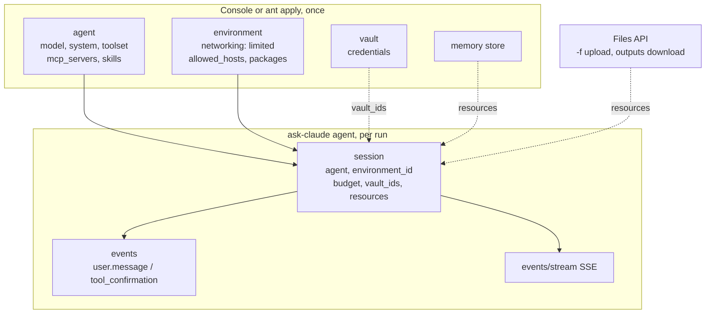
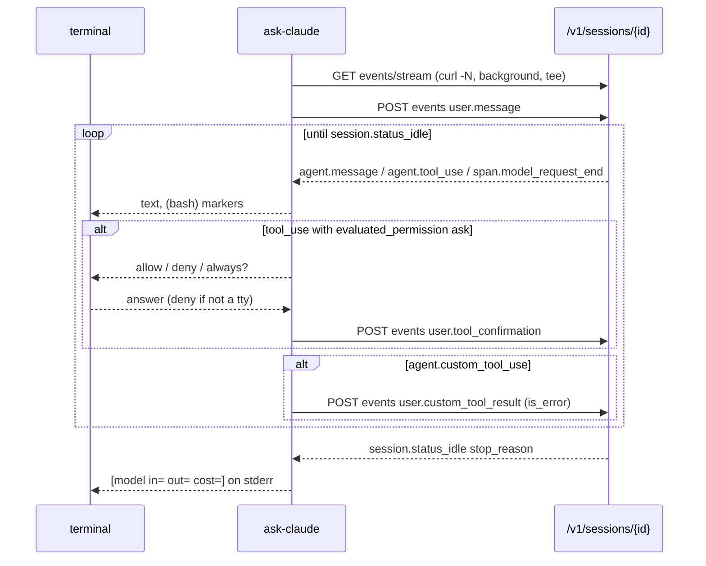

# feat: Sessions on Managed Agents, and the Console's resources, as ask-claude 0.2.x

## Summary

Add an `agent` command to ask-claude that runs a prompt, or a chat, as a
Managed Agents **session** against an agent and an environment created in the
Console. Everything a session can carry (files in and out, vaults, MCP
servers, memory stores, a mounted repository) arrives as a flag on that one
command, one EffVer micro at a time. The Messages API path stays as it is;
sessions are a second transport beside it, not a replacement.

## Problem Frame

ask-claude 0.1.4 does what claude.sh did: `/v1/messages`, streaming, history
files, Agent Skills in the code-execution container. That container has no
network and no package installs, and a skill cannot see this machine. The
plan's next line (`TODO: tools that run locally, and the agent loop`, 1.1.0)
answers the second half: tools on this machine.

Managed Agents answers the first half: an Anthropic-run sandbox **with**
network, packages, web tools, MCP servers, secrets substituted at egress, and
a transcript kept by the API. The Console already creates the pieces (agents,
environments, vaults, memory). What is missing is a shell client that uses
them with the same shape as `ask-claude "question"`: stream the reply, say
what it cost, exit with a code that means something.

Not a goal: managing those resources from ask-claude. The Console and `ant
apply` own creation; ask-claude takes ids.

---

## Requirements

**Sessions**

- R1. `ask-claude agent "prompt"` creates a session from an agent id and an
  environment id, sends the prompt, streams the reply, and exits 0 when the
  session goes idle with `end_turn`.
- R2. `ask-claude agent` with no prompt opens a chat on a new session: each
  line is a `user.message`, `/quit` exits, Ctrl-C sends `user.interrupt`.
- R3. `ask-claude agent list` prints the sessions the API knows, newest first,
  with id, title, status, and spend. `ask-claude agent resume <sesn>` continues
  one; a unique prefix is enough.
- R4. The stream prints what the agent says as it arrives, one marker per
  tool call (`(bash)`, `(web_fetch example.com)`, `(mcp linear)`), and a usage
  line on stderr at idle: model tokens and list cost so far.
- R5. The agent and environment come from `--agent` and `--environment`, each
  with an env var fallback (`ASK_CLAUDE_AGENT`, `ASK_CLAUDE_ENVIRONMENT`);
  with neither, exit 2 and say where to find the ids in the Console.
- R6. A session that stops for a tool confirmation asks on a terminal
  (`allow / deny / always for this session`) and denies when stdin is not a
  terminal, the rule the 1.1.0 line already sets for local tools.

**Cost and safety**

- R7. Every session is created with a budget, 100 cents unless `--budget`
  says otherwise; `--budget 0` means none. `budget_reached` is reported on
  stderr with the command that raises it.
- R8. An `agent.custom_tool_use` event is answered with an error result
  saying ask-claude runs no local tools yet; the session is not left hanging.
- R9. The key never appears on a command line: the same `-H @<(printf ...)`
  and `--data-binary @-` shape as `call()`.
- R10. Exit codes keep their meaning: 0 reply, 1 API or session error
  (`session.error`, `session.status_terminated`), 2 bad input.

**Files**

- R11. `-f FILE` on `agent` uploads the file through the Files API and
  attaches it to the session as a `file` resource, instead of pasting its
  text into the prompt.
- R12. `ask-claude agent files <sesn>` lists what the agent wrote to
  `/mnt/session/outputs/` and downloads what is named, into the current
  directory, never overwriting without `--force`.

**Resources**

- R13. `--vault <vlt_id>` (repeatable) passes vault ids on session create.
  Credentials themselves are created in the Console.
- R14. `--repo <url>[@<branch>]` mounts a GitHub repository at
  `/workspace/<name>` with the token from `GITHUB_TOKEN`.
- R15. `--memory <id>` (repeatable, up to 8) attaches memory stores;
  `--memory <id>:ro` attaches one read-only.

**Development**

- R16. Every behaviour above runs offline under bats through
  `ASK_CLAUDE_REPLAY` and `ASK_CLAUDE_REQUEST_LOG`, with recorded session
  streams as fixtures and jq goldens as before.
- R17. The live contracts in `tests/agents/*.hurl` list and read; the one
  that creates a session archives it in the same file. `just test` does not
  run them; `just test-agents` does.
- R18. Each `lib/*.jq` for sessions is a complete `jq -f` program with the
  same argument discipline as the Messages ones, so the Rust port has one
  shape to match.

**Documentation**

- R19. README gains an "Agents" section: the three things to create in the
  Console (environment with limited networking, agent, optionally a vault),
  where the ids are, the trace URL, and what a session costs.

---

## Key Technical Decisions

- **Sessions are a second transport, not a provider.** `-p` keeps meaning
  "which API shape" (anthropic, openai). `agent` is a subcommand because its
  history, streaming, and exit conditions differ from `/v1/messages`: the
  transcript lives on the API, the stream is `GET .../events/stream`, and
  "done" is `session.status_idle`, not `message_stop`.
- **The API is the history.** No local JSON array for sessions. The state dir
  keeps one small file per session (`<sesn>.session`: title, agent id,
  created) so `list` can show spend from `GET /v1/sessions/{id}` and
  `resume` can take a prefix. Deleting the file forgets nothing the API knows.
- **One stream per turn.** Open the SSE stream, send the message, read until
  idle, close. The docs say a stream delivers only events emitted after it
  opens, and reconnect is "open a new stream, list history, skip seen ids".
  Per-turn streams need none of that, and a chat loop is already one turn at
  a time. Events between turns are not needed by a terminal client.
- **Console and `ant apply` own the resources.** ask-claude never POSTs to
  `/v1/agents`, `/v1/environments`, or `/v1/vaults`. Ids come from flags and
  env vars; `just agents` and `just environments` list them for copying. This
  keeps the client stateless and the blast radius of a typo small.
- **Budget on by default.** Session time is billed per active second and a
  looping agent has no natural end. 100 cents is enough for a question and
  too little for a surprise. `budget` can only be set at creation, so the
  default has to be there.
- **Deny when unattended.** Same rule as the local tool loop: a confirmation
  with nobody at the terminal is a deny. `always` is per process, never
  persisted.
- **Printer and folder stay jq files.** `lib/session.jq` prints the stream
  (like `lib/stream.jq`); `lib/session-usage.jq` folds `session.usage` and
  `span.model_request_end` into the usage line (like `lib/reassemble.jq`).
  Goldens from recorded streams, the oracle rule unchanged.
- **Bash first, then Rust.** 0.2.x lands in bash before R0, so the R8 parity
  gate covers sessions and the bash script stays the oracle. The Rust
  `Provider` trait gains a `Sessions` transport beside `Anthropic` and
  `OpenAiCompatible`.

---

## High-Level Technical Design

What ask-claude references, and what it creates:

One turn, the shape `call()` takes for sessions:

Stop reasons map to exits and messages: `end_turn` → 0; `requires_action`
with ids ask-claude already answered → keep reading; `budget_reached` → 0,
stderr `[stopped: budget_reached, raise it with: ask-claude agent budget
<sesn> <cents>]`; `session.error` or `status_terminated` → 1.

Where versions land on the existing line:

| Version | Effort | Carries |
|---|---|---|
| 0.2.0 | macro | `agent` one shot, chat, list, resume; confirmations; budget; printer and usage goldens; `just test-agents` |
| 0.2.1 | micro | `-f` through the Files API; `agent files` list and download |
| 0.2.2 | micro | `--vault`, `--repo`, `--memory`; README on Console setup for each |
| 0.2.3 | micro | `agent budget <sesn> <cents>`, `agent archive`, `agent trace` (prints the Console URL) |

0.2.0 is macro because it is a new surface with its own costs and a Console
prerequisite, not because anything existing changes. `just effort-floor`
will say micro, since nothing breaks; the label records the effort to adopt
the new surface, and `agent` needs an agent and an environment made in the
Console first.

---

## Scope Boundaries

### Deferred to follow-up work

- Scheduled deployments (`/v1/deployments`): the Console's cron form is the
  right place; a later `agent runs <deployment>` could list runs.
- Custom tools that run on this machine during a session
  (`agent.custom_tool_use` → run → `user.custom_tool_result`): this is the
  1.1.0 local tool loop with a second caller. 0.2.x answers them with an
  error result so the session never hangs.
- Self-hosted environments and their worker.
- Multiagent threads and dynamic workflows (`session.thread_*`,
  `workflow_run.*`): print them as markers, do nothing else.
- `event_deltas[]` token previews on the stream: 0.2.0 prints buffered
  `agent.message` events; deltas when a recorded fixture exists.

### Outside this product's identity

- Creating or editing agents, environments, vaults, credentials, memory
  content. Those are Console and `ant` jobs; ask-claude is a client.
- A TUI. The loop stays `read -e`, like the chat.

---

## Implementation Units

Each `test:` commit is red; its `feat:` child turns it green, the rule in
`docs/plan.md`. Fixtures are recorded once against the live API and
redacted, as the Messages ones were.

### U1. Record session fixtures and goldens

- **Goal:** One recorded session stream per shape, and the goldens claude.sh
  never had: `tests/fixtures/sessions/text.sse` (one message, idle
  `end_turn`), `tool-use.sse` (bash tool with `evaluated_permission`
  `always_allow`), `confirm.sse` (one `ask`, answered allow, then idle),
  `budget.sse` (`budget_reached`), `custom-tool.sse`, `error.sse`
  (`session.error`). Each with `.stream.txt` (what prints) and `.usage.json`
  (what the usage folder returns).
- **Requirements:** R16, R18
- **Dependencies:** a Console environment and agent; the ids go in `.env` as
  `ASK_CLAUDE_AGENT`, `ASK_CLAUDE_ENVIRONMENT` for the recording script only.
- **Files:** `tests/fixtures/sessions/*`, `tests/record-session.sh`
  (records one shape, redacts ids), `tests/unit/00-harness.bats` (fixtures
  parse, every one ends in `session.status_idle` or `session.error`).
- **Approach:** the recording script is the only thing in the repo that
  creates sessions by hand, with a 50-cent budget and archive at the end.
  Redact `sesn_`, `sevt_`, `agent_`, `env_` ids the way `msg_FIXTURE` is.
- **Test scenarios:** harness: every fixture parses as SSE and the last
  event is idle, error, or terminated; the `.usage.json` goldens are valid
  JSON with `model`, `input_tokens`, `output_tokens`, `list_cost`.
- **Verification:** `bats tests/unit/00-harness.bats` green with the new
  fixtures; `tests/record-session.sh text` reproduces `text.sse` modulo ids.

### U2. lib/session.jq and lib/session-usage.jq

- **Goal:** The printer and the usage folder for a session stream, as
  complete `jq -f` programs with goldens.
- **Requirements:** R4, R18
- **Dependencies:** U1
- **Files:** `lib/session.jq`, `lib/session-usage.jq`,
  `tests/unit/session.bats`, `tests/unit/session-steps.bats`.
- **Approach:** `session.jq` runs per event (`-rj --unbuffered`), like
  `stream.jq`: `agent.message` text blocks, `(bash)`, `(web_fetch host)`,
  `(mcp name)`, `(thinking)`, a newline at idle, everything through `safe`.
  `session-usage.jq` is slurped: the last `session.usage` plus the sum of
  `span.model_request_end.model_usage`, output in the shape the usage line
  reads. Both ignore unknown events, so new event types print nothing.
- **Patterns to follow:** `lib/stream.jq` (safe, per-event), `lib/reassemble.jq`
  (seed object, key order), `tests/unit/stream-steps.bats` (one step per
  event type, tagged).
- **Test scenarios:** text fixture prints the golden bytes; tool-use fixture
  prints `(bash) ` before the next text; control characters in an
  `agent.message` never reach the terminal; an unknown event type prints
  nothing; usage golden byte-equal for every fixture; a stream with no
  `session.usage` yields zeros, not null.
- **Verification:** `session.bats` and `session-steps.bats` green; `just
  step agent.message` runs one step.

### U3. The agent command in the spec

- **Goal:** `#USAGE` declares `agent [prompt]` with subcommands `list`,
  `resume <session>`, `files <session>`, and flags `--agent`,
  `--environment`, `--budget <cents>`, `--vault`, `--repo`, `--memory`,
  `--force`. Until each is built it is refused the way 0.1.0 refused
  `list`, with the version in the message.
- **Requirements:** R5, R10
- **Dependencies:** none
- **Files:** `ask-claude` (`#USAGE` block and the refusal block),
  `tests/unit/spec.bats`, `tests/unit/refuse.bats`.
- **Approach:** `agent` is a `cmd` with its own `cmd`s and `arg "[prompt]"`;
  `--agent` and `--environment` carry `env="ASK_CLAUDE_AGENT"` /
  `env="ASK_CLAUDE_ENVIRONMENT"` so usage fills them. `usage diff` against
  the 0.1.4 spec must report additions only.
- **Test scenarios:** `usage explain` binds every new flag and the three
  subcommands; `agent "hi"` with no agent id exits 2 and names the Console;
  `agent files x` is refused with the version until U8; the 0.1.4 spec diff
  has 0 breaking changes.
- **Verification:** `spec.bats` green, `just lint` clean, `just
  effort-floor` says micro.

### U4. One shot through a session

- **Goal:** `ask-claude agent "prompt"` creates the session with
  `initial_events` and a budget, streams one turn, prints the usage line,
  exits by stop reason.
- **Requirements:** R1, R4, R5, R7, R9, R10, R16
- **Dependencies:** U2, U3
- **Files:** `ask-claude` (`session_create`, `session_turn`,
  `session_transport`), `lib/session-create.jq` (request body builder, `-n`
  with `--arg` like `request.jq`), `tests/fixtures/agents/create-*.json`
  (request goldens), `tests/unit/agent.bats`.
- **Approach:** `session_transport` mirrors `transport()`: replay reads the
  fixture, live runs `curl -N` on the stream in the background into a tee,
  then POSTs the message; the printer reads the tee until it sees idle, then
  the background curl is killed. `ASK_CLAUDE_REQUEST_LOG` records the create
  body and each events body, one line each. The state dir gets
  `<sesn>.session` after a successful create. The usage line is
  `[model in=N out=N cost=$0.NN sesn_...]` so the id is on screen for
  `resume` and `trace`.
- **Execution note:** start from the request golden for `session-create`
  and the replay of `text.sse`; the live path is checked by hand and by
  `just test-agents`.
- **Patterns to follow:** `call()` (log file, grep for `data:`, error
  extraction, rollback discipline), `oneshot.bats` (replay helper, request
  log assertions).
- **Test scenarios:** replay text: stdout is the golden, stderr has the
  usage line, `requests.jsonl` has a create body with `budget.max_list_cost
  .amount == "100"` and one `user.message`; `--budget 0` sends no budget;
  `--budget abc` exits 2 before any request; replay error: exit 1, stderr
  has the error message; replay budget: exit 0, stderr says how to raise
  it; no key: exit 2 before any request; `<sesn>.session` is written after
  create and not on an error.
- **Verification:** `agent.bats` green; by hand with a 50-cent budget:
  streams, usage line shows cost, the Console trace shows one session.

### U5. Chat, resume, list

- **Goal:** `ask-claude agent` with no prompt loops over a session;
  `resume <sesn>` continues one; `list` shows sessions from the API.
- **Requirements:** R2, R3
- **Dependencies:** U4
- **Files:** `ask-claude` (`session_loop`, `session_list`,
  `session_find`), `lib/session-list.jq`, `tests/unit/agent-chat.bats`.
- **Approach:** `session_loop` is `chat_loop` with `session_turn` in place
  of `ask`; `/history` prints `GET .../events?types[]=user.message&types[]=
  agent.message` through `session.jq`; Ctrl-C in a turn sends
  `user.interrupt` and keeps reading until idle. `list` reads `GET
  /v1/sessions?order=desc`, one line: id, status, title, cost. `resume`
  resolves a prefix against the state dir first, then the API.
- **Test scenarios:** stdin `hi\n/quit\n` with replay: one create, one
  `user.message`, exit 0; `/history` prints `you:` and `agent:` lines from a
  replayed events page; `resume <prefix>` with one match sends to that id
  and creates nothing; two matches exit 2; `list` on a replayed page prints
  newest first; `list` with no sessions prints nothing, exit 0; an interrupt
  fixture (`interrupt.sse`) ends the turn with `end_turn`.
- **Verification:** `agent-chat.bats` green; by hand: a two-turn chat, quit,
  resume it, `/history` shows all four lines.

### U6. Tool confirmations and custom tool refusal

- **Goal:** A session that stops with `requires_action` is answered: a
  confirmation is asked on a terminal and denied otherwise; a custom tool
  call gets an error result.
- **Requirements:** R6, R8
- **Dependencies:** U4
- **Files:** `ask-claude` (`session_answer`), `tests/unit/agent-confirm.bats`.
- **Approach:** the printer emits a marker line the shell can parse
  (`\x01ask sevt_...\n`, stripped by `safe` from anything the model wrote)
  so `session_turn` can prompt without a second jq pass; the answer is
  `user.tool_confirmation` with `allow` or `deny`; `always` sets a shell
  variable for the process. `agent.custom_tool_use` gets
  `user.custom_tool_result` with `is_error: true` and the text "ask-claude
  <version> runs no local tools; see docs/plan.md".
- **Test scenarios:** confirm fixture with stdin `y`: one
  `user.tool_confirmation` with `allow`; with stdin `n`: `deny`; stdin not a
  tty and no answer available: `deny`, stderr says so; `always`, then a
  second ask in the same turn: no prompt, `allow`; custom-tool fixture: one
  `user.custom_tool_result` with `is_error` and the version in the text.
- **Verification:** `agent-confirm.bats` green; by hand with an agent whose
  bash policy is `always_ask`: the prompt appears, `n` denies, the agent
  reports the denial.

### U7. Live contracts and the just recipes

- **Goal:** `just test-agents` pins the session contract live; `just agents`
  and `just environments` list what the Console has.
- **Requirements:** R17, R19
- **Dependencies:** U4
- **Files:** `tests/agents/sessions.hurl` (create with a 10-cent budget,
  send one message, poll events until idle, assert `agent.message` and
  `session.status_idle`, archive), `tests/agents/list.hurl`, `justfile`,
  `README.md`.
- **Approach:** the recipes read `.env` like `test` and `test-openai`;
  `agents` and `environments` print `id  name  model|networking` like
  `just skills`. README "Agents": create an environment (limited
  networking, `allowed_hosts` for what the job needs, package managers only
  if packages are set), create an agent (model, system, web tools off unless
  needed, bash policy), copy both ids into `.env`, run `ask-claude agent
  "hello"`, open the trace URL, what a session costs (tokens at list price,
  $0.08 per active hour, $10 per 1,000 web searches).
- **Test scenarios:** `just --list` parses; `test-agents` is not reachable
  from `test`; hurl asserts above pass live; `just agents` prints at least
  the agent used for recording.
- **Verification:** `just test-agents` 2/2 files live; README section reads
  top to bottom as a setup a new user can follow.

### U8. Files in and out

- **Goal:** `-f` uploads through the Files API and attaches the file;
  `agent files <sesn>` lists and downloads outputs.
- **Requirements:** R11, R12
- **Dependencies:** U4
- **Files:** `ask-claude` (`file_upload`, `session_files`),
  `lib/files-list.jq`, `tests/unit/agent-files.bats`,
  `tests/fixtures/agents/files-list.json`.
- **Approach:** upload is `POST /v1/files` multipart, the `file_id` goes
  into `resources` on create; `files` is `GET /v1/files?scope_id=<sesn>`
  then `GET /v1/files/{id}/content` per name, written with `umask 077`, no
  overwrite without `--force`. Replay for uploads: `ASK_CLAUDE_REPLAY_FILES`
  points at a directory of canned responses, or the request log alone
  proves the shape; decide at implementation.
- **Test scenarios:** `-f notes.md "summarize"` logs one upload and a create
  with a `file` resource, the prompt is not prefixed; unreadable file exits
  2 before any request; `files <sesn>` prints names and sizes from the
  fixture; download writes mode 600; an existing name exits 2 without
  `--force`; with `--force` it overwrites.
- **Verification:** `agent-files.bats` green; by hand: upload a file, ask
  the agent to write one, download it.

### U9. Vaults, repository, memory on the session

- **Goal:** `--vault`, `--repo`, `--memory` reach `vault_ids` and
  `resources` on create; README says what to create in the Console for each.
- **Requirements:** R13, R14, R15, R19
- **Dependencies:** U4
- **Files:** `ask-claude`, `lib/session-create.jq`,
  `tests/fixtures/agents/create-resources.json`, `tests/unit/agent.bats`,
  `README.md`.
- **Approach:** `--repo owner/name@branch` becomes a `github_repository`
  resource at `/workspace/name` with `GITHUB_TOKEN`; no token exits 2 before
  any request. `--memory id:ro` sets `access: read_only`; more than 8 exits 2.
  README: vault credentials are made in the Console (header injection by
  default), the environment's `allowed_hosts` must include the credential's
  host, MCP servers are declared on the agent and authorised by the vault.
- **Test scenarios:** request golden with two vaults, a repo with a branch,
  two memories one read-only; `--memory` nine times exits 2; `--repo`
  without `GITHUB_TOKEN` exits 2 and names the variable; the token is in the
  logged body only, never in a command line (check `/proc/<pid>/cmdline`
  the way qxwy did).
- **Verification:** `agent.bats` green; by hand: a session with the vault
  that holds a Linear MCP token lists issues.

### U10. Session operations

- **Goal:** `agent budget <sesn> <cents>`, `agent archive <sesn>`,
  `agent trace <sesn>` (prints the Console URL for the workspace).
- **Requirements:** R7, R3
- **Dependencies:** U5
- **Files:** `ask-claude`, `tests/unit/agent-ops.bats`, `README.md`.
- **Approach:** `budget` is `POST /v1/sessions/{id}` with the new cap and
  must exceed consumed cost (the API says so with 400; print its message);
  `archive` refuses a running session (API 409, printed); `trace` needs the
  workspace id, `ASK_CLAUDE_WORKSPACE`, default `default`.
- **Test scenarios:** `budget` logs the body with the amount as a string of
  cents; `budget x 0` sends `"budget": null`; `archive` on a replayed 409
  exits 1 with the message; `trace` prints the URL with the workspace.
- **Verification:** `agent-ops.bats` green; by hand: raise a
  `budget_reached` session and watch it resume.

### U11. Versions 0.2.0 to 0.2.3

- **Goal:** `just bump` and a CHANGELOG section per version, with the gate
  each `TODO(verifier)` lists, in the shape 0.1.x used.
- **Requirements:** all
- **Dependencies:** U4..U7 for 0.2.0; U8 for 0.2.1; U9 for 0.2.2; U10 for
  0.2.3.
- **Files:** `VERSION`, `CHANGELOG.md`, `ask-claude` (version line),
  `docs/plan.md` (a phase 3b table mirroring this plan's units).
- **Test expectation:** none -- version metadata; `just check-effver` and
  `just check-version-line` are the checks.
- **Verification:** `check-effver` passes on the stack; 0.2.0's section ends
  with "To adopt:" naming the Console prerequisites.

---

## Risks & Dependencies

- **Managed Agents is in beta** (`managed-agents-2026-04-01`). Event names
  and the stream framing can change. Mitigation: fixtures are recorded, the
  printer ignores unknown events, and `just test-agents` is the canary.
- **The SSE framing of the session stream is not shown in the docs** beyond
  the `accept` header and one example. U1 records it before anything is
  written against it.
- **Cost without an end.** A session keeps running while the agent works.
  The default budget and the deny-when-unattended rule bound it; the usage
  line shows cost per turn.
- **Two background processes per turn** (curl on the stream, the printer).
  Killing the stream after idle must not lose the tail of the tee; `call()`
  has the same shape with one process. Decide at implementation whether
  the printer or the shell does the kill.
- **Divergence from the Rust line.** If R0..R8 start before 0.2.x lands,
  the parity gate grows after the fact. See Open Questions.
- **Console as a prerequisite.** A user without Console access cannot use
  `agent` at all. The README says so first.

---

## Open Questions

- Does 0.2.x go before R0 (bash first, oracle rule, R8 covers it) or after
  1.0.0 (sessions written once, in Rust)? The plan assumes before; the
  Rust port then has one more transport to match.
- `event_deltas[]`: is the opt-in shape documented well enough to record a
  fixture, so 0.2.0 can print tokens instead of whole messages? If not,
  buffered `agent.message` is the 0.2.0 behaviour.
- Should `agent list` show only sessions with a `<sesn>.session` file, or
  everything the API returns for the workspace? The plan says everything,
  newest first, because the API is the history.

---

## Assumptions

- The Console-created agent and environment are usable by id from an API
  key in the same workspace. The docs imply it; U1 confirms it on the first
  recording.
- `GET /v1/sessions/{id}` returns spend in a field the usage line can read.
  If not, the line shows tokens only until the field is found.
- `anthropic-version: 2026-10-21` with the managed-agents beta header works
  the way the examples show.

---

## Sources

- `docs/plan.md` phase 2 (seams: `ASK_CLAUDE_REPLAY`, `ASK_CLAUDE_REQUEST_LOG`,
  state dir) and phase 4 (`Provider` trait).
- `ask-claude`: `transport()`, `call()`, `chat_loop()`; the shapes U4
  and U5 mirror.
- `.claude/skills/claude-api/curl/managed-agents.md`: raw HTTP for agents,
  sessions, events, confirmations, custom tool results, files.
- platform.claude.com/docs/en/managed-agents: overview, quickstart,
  sessions, events-and-streaming, environments, tools, vaults, budgets,
  reference (event types, stop reasons, rate limits), skills,
  session-operations.
- Code execution container limits (no network, 5 GiB, 30-day container):
  platform.claude.com/docs/en/agents-and-tools/tool-use/code-execution-tool.
