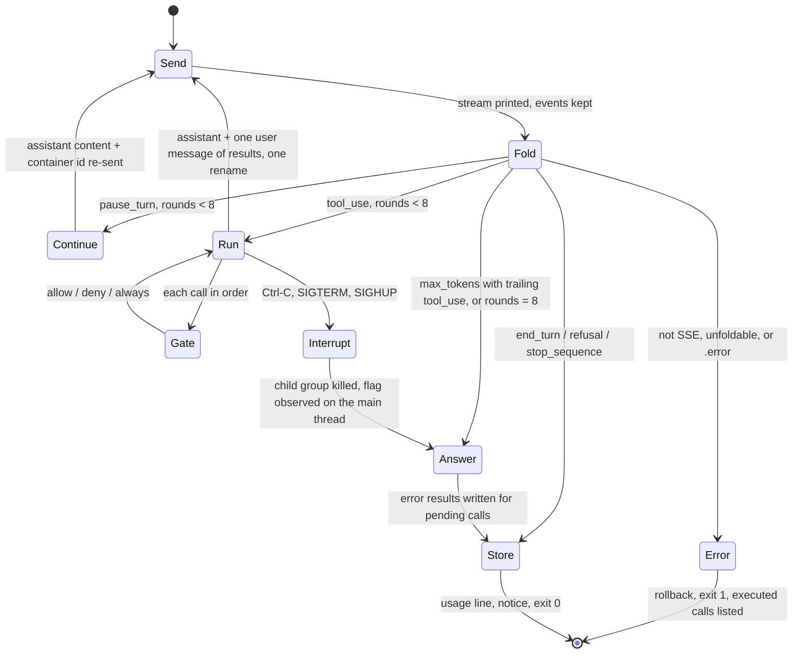
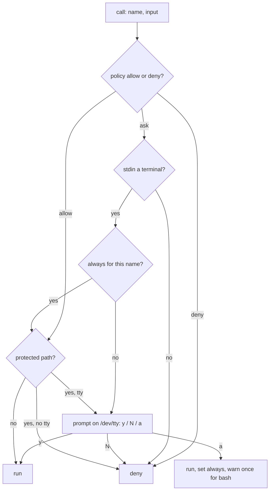

<!-- markdownlint-disable-next-line MD025 -- the front-matter title is metadata -->
# Rust Parity and Local Tools - Plan

## Goal Capsule

- **Objective:** On a machine that cannot run Claude Code, one static binary
  answers a question, keeps a chat, and edits files and runs commands in the
  current repository under the user's approval, with the same request shapes,
  exit codes and safety rules the bash script established.
- **Means:** Finish the Rust port to parity with the bash oracle (KTD1), then
  build the local tool loop, skills and plugins on the Rust binary only (KTD1,
  KTD12), with the two shared changes landing in both versions first (KTD16,
  KTD17).
- **Authority:** This plan over the TODO commits it refines. `docs/plan.md` over
  this plan for what each unit must validate. `CODING_STANDARDS.md` and
  `REVIEW.md` over both for how code is written and reviewed. `AGENTS.md` for
  the loop every unit follows.
- **Execution profile:** One line of commits in jj, no pull requests. Two
  milestones: 1.0.0 at the parity gate, step R8 of the phase-4 table in
  `docs/plan.md` (U1 to U9), then 1.1.0 at the plugin gate (U10 to U14). Step
  labels from that table (R0 to R8, and the `r2_*` test prefixes) are not this
  plan's requirement IDs. Each unit is a test commit then a feat commit; each
  milestone ends in a verified commit, then a version commit.
- **Stop conditions:** A golden that must change for the Rust binary to pass,
  without a reason the oracle was wrong. A usage spec diff that reports a
  breaking change. A unit whose test cannot be made red on its parent. The
  EffVer tooling unable to express 1.0.0 when the version commit is due.
- **Who finishes:** The maintainer writes the Rust and the bash fix; an agent
  writes tests, fixtures, goldens, TODO and verifier commits and runs the gates,
  as `AGENTS.md` states.

---

## Product Contract

### Summary

Take the Rust crate from a scaffold with two real modules to a binary that
passes the whole bats suite, the usage spec diff and the live contracts, and cut
1.0.0. On that binary, add Anthropic's bash and text editor tools run on this
machine behind the session confirmation gate, an agent loop over them, a `skill`
tool with a skills index, and plugins in Claude Code's format, proven end to end
with the vendored coding-tutor plugin, and cut 1.1.0. Before either, strip
bidirectional controls in `safe` and accept `ANTHROPIC_BASE_URL`, in both
versions.

### Problem Frame

felixia cannot run Claude Code, and Docker is too heavy beside Immich on it.
ask-claude in bash runs there, but it is a client, not an assistant: it cannot
edit a file or run a command. The CodeCrafters course that started this project
builds exactly that loop. The repository already planned the loop as empty TODO
commits on top of a Rust 1.0.0, and the Rust line stopped at a half-written
transport with every unit below it still a `todo!()`. Meanwhile `ant`, the
official CLI, settled names a user of both tools would expect to match, and its
terminal sanitizer strips bidirectional controls that the bash `safe` passes
through, which matters once a command is displayed for approval.

### Key Decisions

- **The three pieces are planned together, over merging the compound-engineering
  docs line first.** (session-settled: user-directed — chosen over the docs
  merge: the port and the loop are the work felixia waits on) Governs R1 to R24.
- **Local tools are built in the Rust binary only; bash never gets a tool loop
  and stays the oracle for what it already does.** (session-settled:
  user-approved — chosen over tools in bash first: the TODO graph places 1.1.0
  above 1.0.0, and bash cannot replay a directory of turns) Governs R8 to R18.
- **Both kinds of skill stay: Anthropic's container skills through `-s`, local
  skills through the loop.** (session-settled: user-approved — chosen over local
  only: the open decision TODO assumed both, and `-s` has users) Governs R14,
  R16, R17.
- **`ant` alignment stops at names a user types or exports.** (session-settled:
  user-approved — chosen over adopting its command grammar and `--format`: a
  rename is a breaking usage spec change under the effort floor) Governs R22.
- **The bidi fix lands in bash first, as a fix commit with every golden
  unchanged, and the Rust `safe` inherits it.** (session-settled: user-approved
  — chosen over leaving `safe` as it is: the approval prompt displays the
  command) Governs R21.
- **The Rust chat loop gets line editing with bracketed paste.**
  (session-settled: user-approved — chosen over plain stdin: the plan's known
  bug on macOS waits for this) Governs R5.
- **Approval is the only boundary in 1.1.0; there is no OS sandbox.** A bash
  command can reach everything the user's account can, and the README says so.
  Governs R10, R11.

### Requirements

#### Parity (1.0.0)

- R1. Every jq twin in the crate reproduces its golden: reassembled messages by
  JSON value, printed streams and session streams byte for byte, request bodies
  and session create bodies by value.
- R2. A one-shot through the replay seam prints the reply as it arrives, writes
  the usage line and stop notice on stderr, saves the chat, and exits with the
  bash script's codes.
- R3. The live Messages path streams from the API through the same printer, with
  the key and body off every command line and 4xx bodies surfaced as the bash
  `API error` message.
- R4. Chats on disk, `list`, `resume`, the container file and rollback on
  failure behave as the bats suite pins them, with the file name shape, the
  stored `{role, content}` shape and the `$STATE/*.json` glob unchanged.
- R5. The chat loop reads plain lines without a prompt when stdin is a pipe, and
  on a terminal offers line editing where one paste is one turn; Ctrl-C exits
  130 and Ctrl-D runs the quit epilogue.
- R6. Sessions: one shot, chat, resume, list, files, budget, archive, trace,
  confirmations and the custom-tool error result match the bash behaviour and
  fixtures; Ctrl-C sends `user.interrupt` and exits 130.
- R7. `-p openai` with `--base-url` works in Rust against an OpenAI-compatible
  API, and `just parity` reports no breaking difference between the two usage
  specs.

#### Local tools and the loop (1.1.0)

- R8. Local tools are off unless `--tools` or `ASK_CLAUDE_TOOLS` turns them on;
  without it no request body or system prompt changes.
- R9. With tools on, the request declares `bash_20250124`,
  `text_editor_20250728` and the `skill` tool, and a `tool_use` stop runs every
  call in order, returns all results in one user message, and re-sends with
  identical tools until a different stop reason.
- R10. Every call passes the confirmation gate: `ASK_CLAUDE_CONFIRM` or
  `--confirm` with `ask`, `allow`, `deny`; no terminal means deny with the
  existing message; `always` lasts for this process and this tool name, and the
  user is told on stderr when a grant removes the prompt for bash.
- R11. A bash call runs in the repository root in its own process group with a
  timeout and an output cap enforced while reading, its stdin on `/dev/null`,
  its command off every command line, and an environment built from an allowlist
  so no secret from `.env` reaches it, and the secrets this process holds are
  redacted from its result.
- R12. Every editor command, `view` included, reads and writes only inside the
  canonicalized repository root, refuses symlink escapes and `create` over an
  existing file, prompts for a protected path even under a standing grant and
  denies it without a terminal, and returns Anthropic's documented error
  strings.
- R13. No chat is ever saved with a trailing unanswered `tool_use`: the
  assistant turn and its results are written in one rename, and an interrupted,
  truncated or capped round is answered with an error result before that write.
- R14. `-s`, `--web` or `--mcp` together with `--tools` is refused with exit 2
  in 1.1.0, and a session's custom tools keep today's error result.

#### Skills and plugins (1.1.0)

- R16. With tools on, the system prompt carries an index of every discovered
  skill's name and description inside one delimited block that names its origin
  as files on disk, and the body is loaded only when the model calls the `skill`
  tool.
- R17. Skills are discovered from the project, the user's home and enabled
  plugins, skipping any entry whose canonical path leaves its root or whose root
  another account can write; `${CLAUDE_PLUGIN_ROOT}` is substituted in a plugin
  skill's body and exported to its commands for the rest of the activation.
- R18. `ask-claude plugin enable`, `disable` and `list` manage plugins from a
  relative-path marketplace, and only a human `enable` activates one. A plugin's
  `commands/*.md` become `/name` commands typed, piped or given as the one-shot
  argument, built-in commands win, and an unknown `/word` costs no request.
- R19. The coding-tutor plugin runs end to end offline: `/teach-me` on a
  recorded replay runs its setup script with the plugin root set, under a
  temporary home.
- R20. `/history` and `list` render tool calls and results through `safe`, and
  the printer marks a running tool.

#### Shared changes (both versions)

- R21. `safe` also drops the nine bidirectional formatting characters, in every
  definition, with every existing golden unchanged.
- R22. `ANTHROPIC_BASE_URL` is the environment twin of `--base-url` for the
  Anthropic provider under the same validation, announced on stderr when it
  takes effect; the test-only `ASK_CLAUDE_BASE_URL` is retired.

#### Gates

- R23. Every gate passes at zero failures, with environment-bound and
  binary-bound tests excluded by tag in the command.
- R24. Each milestone ends in a verified commit listing every command and
  result, then a version commit whose effort the usage spec diff justifies.

### Success Criteria

- The verified commit for 1.0.0 shows `just test-rust`, `just parity`, `just
  test`, `just test-openai` and `just test-agents` green in one run, names which
  bats files exercised the Rust binary, and records the manual bracketed-paste
  check on macOS.
- The verified commit for 1.1.0 shows the tool loop gate and the coding-tutor
  gate green on recorded replays, with no network.

### Scope Boundaries

- Not in this plan:
  - `ant`'s auth, profiles, cloud gateways, TUI and `apply`.
  - Remote marketplaces, plugin hooks, agents, MCP servers, plugin `bin/` on
    `PATH`, and `!` command injection in skill bodies.
  - An OS sandbox for tool commands, and persisted allow rules.
  - Re-recording the session fixtures, which has its own TODO chain.
  - The sem and weave colocation decision, and merging the compound-engineering
    docs line.
  - Fixing the state-directory lead in bash; the Rust binary closes its code
    side (U5) and bash keeps it until retired.
- Considered and not built:
  - A persistent bash session across calls. The docs allow either shape, one
    process per call is simpler, and a fixture showing the model relying on `cd`
    would change the call.
  - A text allowlist for bash commands. Claude Code documents that wrappers and
    substitutions escape it, so every call asks instead.
  - Withholding the `always` answer for bash. The TODO asks for y, n and always;
    the chosen smaller form is the stderr line R10 names, and a fixture of a
    looping model under `always` would reopen this.
  - Checkpointed rollback of completed tool rounds. It changes the history rule
    in `CODING_STANDARDS.md`, so the standard is kept and executed calls are
    reported (KTD18).
  - Per-read idle timeouts on the stream. No recorded long-thinking fixture
    exists to size them against.
  - A full YAML parser for skill frontmatter. The subset KTD14 names covers
    every SKILL.md in reach; a frontmatter the subset rejects is skipped with a
    note.
  - A hard-link check in the editor. A link inside the root to a file outside
    passes both path checks and needs a second principal to plant; accepted as
    Low.
  - Protecting bash from the editor's path rules. The approval text is the
    boundary for bash, and the README says so.

#### Deferred to Follow-Up Work

- `--api-key-stdin`: a behaviour, not a name; it collides with the chat loop
  reading stdin and needs its own commit in both versions.
- `ANTHROPIC_AUTH_TOKEN`, `ANTHROPIC_PROFILE` and a config directory: behaviours
  that reverse the "no config-file fallback" decision.
- `--web` or `--mcp` together with `--tools`, lifted with a recorded fixture and
  a README line on what a tool read can send out.
- A session's custom tools run on this machine through the same runner and gate,
  under names the agent author chooses. Entry conditions: a recorded fixture of
  a real agent calling such a tool, a stated need, and an opt-in separate from
  `--tools`, since a standing `allow` exported for sandboxed sessions must not
  start running local commands.
- A reedline history file under the state directory, as its own decision about
  chat text at rest.
- Marketplaces beyond the repository's own: `extraKnownMarketplaces` entries and
  `enabledPlugins` hints from any `settings.json`.
- An override for the bash tool's 120 s timeout, as an environment variable
  validated like `--max-tokens`; the first build that exceeds it on felixia is
  the evidence for the default.
- Adopting the `web_search_20260209` and later tool variants, which require a
  code execution tool alongside them.
- A `lib/safe.jq` shared through `include`, replacing the four duplicated
  definitions.
- A relative `XDG_STATE_HOME` ignored per the XDG spec, in both versions.
- The two undescribed heads beside the Rust line, left for the maintainer after
  U2 cleans the line itself.

### Open Questions

- Deferred to U13: whether a personal skill shadows a project skill of the same
  name or the reverse. The two research reads of Claude Code's docs disagree;
  one fetch before U13's test commit settles it. Default until then: personal
  beats project, plugin skills namespaced `plugin:skill` on a clash.
- Gate on the 1.0.0 version commit only: `bump-effver` and `check-effver` cannot
  express `0.x` to `1.0.0`; the `1.0` effort is taught in dotfiles first and
  copied here unchanged (KTD6, D1). No unit waits on it; the version commit is
  inserted into the line below U10 when it clears.

---

## Planning Contract

### Key Technical Decisions

- KTD1. **Start the port at R2, on the current Rust line, after cleaning it.**
  Only `sse::*` and `cli.rs` are real; the R5 spike, the R6 and R7 scaffolds
  carry signatures and hints only. The line is not divergent in jj; the seven
  spike commits (`=== RESUME HERE ==`, `dotenv`, `ureq`, two undescribed, `TEMP:
  disable streaming`, `WIP: R5`) get described or squashed before the first feat
  commit. (session-settled: user-directed — the three pieces together, chosen
  over the docs merge first)
- KTD2. **serde_json with `preserve_order`, bytes at the edges.** Goldens carry
  jq's insertion key order; without the feature every emitted object sorts its
  keys. Fixtures are read as bytes and compared as bytes; invalid UTF-8 in a
  line is replaced the way jq does, verified against one crafted line before R2.
- KTD3. **The transport returns a reader; ureq pinned exactly.**
  `Transport::send` yields a reader so one loop prints each `data:` line as it
  arrives and keeps every event for the fold, for replay and live alike. The
  live body is read on a worker thread that hands each line over a channel, and
  the main loop waits with a short timeout and checks the interrupt flag between
  waits, because a signal cannot wake a blocking socket read on every platform.
  The `Replay` counter advances on every send, continuations and tool rounds
  included, and a missing turn file is the "no response" path. Agent config:
  `http_status_as_error(false)` so error bodies surface as the bash `API error`,
  no redirects so the key never follows one, 1800 s global timeout matching
  `curl --max-time`, 30 s connect. The `Logged` transport refuses an existing
  log file that another account owns or can read. Alternatives: reqwest blocking
  brings a runtime for one POST; hand-rolled rewrites the HTTP core.
- KTD4. **The binary never reads `.env`; no panic reaches main.** dotenvy is
  dropped: the key is read from the environment only, and `.env` is read by
  `just`, as `docs/plan.md` decided on 2026-11-02. `umask(077)` and SIGPIPE
  reset to default at the top of main, so files are private and `ask-claude |
  head` exits like curl. `unwrap_used` and `expect_used` denied in the binary
  crate; every API or file input error maps to the bash exit code.
- KTD5. **Chat loop: branch on whether stdin is a terminal, history in memory.**
  A pipe gets plain lines and no prompt, exactly as bash `read -e -p` behaves
  off a terminal, so the bats suite drives it unchanged. A terminal gets
  reedline with bracketed paste on and an in-memory history only: a history file
  would keep typed lines of a chat that left no file, which the Chat concept
  forbids. `Signal::CtrlC` exits 130 without the epilogue, `Signal::CtrlD` runs
  it. (session-settled: user-approved — line editing with bracketed paste,
  chosen over plain stdin)
- KTD6. **The crate version comes from `VERSION`.** `include_str!` of the
  repository file, so `just bump` keeps `-V` and the spec test honest and
  `rust/Cargo.toml` stops carrying a second number. 1.0.0 needs the EffVer tools
  taught a `1.0` effort, in dotfiles first (D1).
- KTD7. **Spec parity through `usage-lib` 7, with the `usage` CLI pinned to the
  same version, bumped first.** `clap_usage` 5.0.0 resolves to `usage-lib`
  5.1.0, which has no `unknown_flags` field and never emits `env`; depending on
  `usage-lib` directly emits `unknown_flags "error"` from clap, and the hand-set
  `env` on `--agent` and `--environment` stays. `usage` is the bash script's own
  argument parser through its shebang, so its bump to 7.3.0 lands in U1 with the
  bash suite green before and after, and the four-platform `mise.lock` refresh
  reviewed there, not in the unit that records the gate. Bash declares every
  Rust-only flag and subcommand in its `#USAGE` block and refuses them with exit
  2, the `-p openai` precedent, so `just parity` stays at zero breaking through
  1.1.0; `plugin` as a command shadows the prompt argument the way `agent` did,
  which the spec test that counts breaks since 0.1.4 records in its own
  test-change commit at U14. The parity gate ends at 1.1.0.
- KTD8. **Gate hygiene before the first Rust run.** Tags: `pty` on the
  bracketed-paste test, `bash-only` on tests that read the script as a file or
  pin bash-only behaviour, `rust-only` on tests of behaviour only the Rust
  binary has, in either milestone. `just unit-tests` excludes `pty` and
  `rust-only`; `just test-rust` excludes `pty` and `bash-only`; a `spec_file()`
  helper feeds `--usage-spec` output, saved under the name `ask-claude`, to
  every place the spec tests hand the binary to `usage`, so they run on both
  binaries. The `.gitignore` exception becomes recursive under
  `tests/fixtures/sse/`, and the harness names a missing fixture. The verified
  commit names which bats files exercised the binary, since the jq and step
  suites never touch it.
- KTD9. **One confirmation gate for both transports, behind `--tools`.**
  `ASK_CLAUDE_CONFIRM` governs the Messages loop and sessions, and `--confirm
  ask|allow|deny` is its CLI twin and wins over it. The Messages path validates
  it only with `--tools`, so a plain one-shot stays byte-identical to bash.
  Order: policy override, then no terminal means deny with the existing message,
  then the `always` grant, then the prompt on `/dev/tty` in the existing wording
  with the input shown compact and encoded once through `safe`. `always` is a
  per-process, per-tool-name boolean in memory, never a file. Narrowing it from
  one grant per process on the sessions transport is an intentional divergence
  recorded in the changelog. Protected paths prompt even under `always` and are
  denied under unattended `allow`. One stderr line when `a` is answered for bash
  and one at start when `allow` is set with `--tools`, so the user knows the
  prompt is gone.
- KTD10. **Tool runner shape.** One function from tool name and input to content
  and error flag, called by the Messages loop and written so a second caller
  could use it later. What it prints to the terminal goes through `safe`; what
  it returns to the model is capped, then the secrets this process holds
  (`ANTHROPIC_API_KEY`, `GITHUB_TOKEN`, `ASK_CLAUDE_MCP_TOKEN`,
  `OPENAI_API_KEY`) are replaced by `[redacted]`, which is partial by nature and
  documented as such.
  - Bash: `bash` from `PATH`, the declared tool type, with an error result "bash
    not found" rather than a dialect change to `/bin/sh`. The command is written
    to a mode 0600 temp file under the state directory and run as `bash <file>`,
    so it is never a process argument and the child's stdin is `/dev/null`; the
    file is removed when the child exits or the interrupt path runs. One process
    per call in its own process group, cwd the repository root, stdout and
    stderr merged into a pipe. 120 s timeout, then the group gets TERM and,
    after a grace period, KILL. 30 000 bytes kept as head and tail around an
    omission marker, enforced while reading so a flooding command never grows
    memory. Environment from an allowlist published in the README: `PATH HOME
    USER SHELL TERM TMPDIR LANG LC_* MISE_* XDG_DATA_HOME XDG_CONFIG_HOME`, plus
    `CLAUDE_PLUGIN_ROOT` while a plugin skill is active; `SSH_AUTH_SOCK` and
    `XDG_STATE_HOME` are left out on purpose. `restart` is answered "Bash
    session restarted".
  - Editor: the root is the canonicalized cwd, and `--tools` is refused at
    `$HOME` or `/`. The path rule applies to every command before it runs,
    `view` included: a path is allowed only when its requested and resolved
    forms both sit under the root and its final component is not a symlink, and
    the final open refuses to follow a symlink. Protected, prompting even under
    `always`: `.git/`, `.jj/`, `.claude/`, `.cargo/`, `Cargo.toml`, `build.rs`,
    `.mcp.json`, `.env`, `mise.toml` and its local variants, `.envrc`,
    `.devcontainer*`, `.vscode/`, `.idea/`, `.husky/`, `.npmrc`, shell rc files,
    the state directory, and an enabled plugin's directory when it lies under
    the root. `create` refuses an existing path with the reference string.
    Writes go through a temp file in the target directory then rename, keeping
    the original mode. `view` numbers lines and lists two levels of a directory.
    The error strings are Anthropic's.
- KTD11. **Persistence in the loop.** The assistant turn and its tool results
  are written in one rename, so a kill before it leaves only the dangling user
  turn bash leaves today. On Ctrl-C, on `max_tokens` with a trailing tool call,
  and when the round cap fires, each pending call gets an error result with a
  fixed text before that write, so `resume` never sends an unanswered
  `tool_use`. Those texts are stored, resent payload and are treated as goldens.
  The signal handler, installed for SIGINT, SIGTERM and SIGHUP, only sets a
  flag. The main thread sees it between channel waits (KTD3) or after the
  child's wait returns, then kills the child's process group with TERM and,
  after a grace period, KILL, writes the results, drops its temp files and exits
  130, abandoning the reader thread to process exit. Two counters: `pause_turn`
  continuations stay at 8 as in bash, and tool rounds have their own cap of 64
  per user turn, after which the pending calls get the error result. A denial is
  an error result reading "denied by the user; do not call this tool again for
  this request" and counts as a round.
- KTD12. **Tools are opt-in and compose into `system` as a string.** `--tools`,
  or `ASK_CLAUDE_TOOLS` set to `1`, `true` or `yes` (`0`, `false`, `no` or empty
  mean off, anything else exits 2 in the `ASK_CLAUDE_CONFIRM` shape), adds the
  bash and editor declarations after the existing `tools` entries, and the
  `skill` declaration from U13 on, and appends the skills index to `system`
  after any `-S` text with a blank line between; nothing changes without the
  flag, so every existing request golden holds and a new golden pins the
  tools-on shape. The index is ordered deterministically and rendered
  identically each turn, since `system` is also the prompt-cache prefix. `-s`,
  `--web` or `--mcp` with `--tools` exits 2: the first gives the model two
  bashes, the other two give anything a tool read a way off the machine that no
  prompt guards.
- KTD14. **Skills: a `skill` tool, an index of frontmatter, substitution plus
  export.** The model loads a body only by calling `skill` with a name. The
  result is the body with `${CLAUDE_PLUGIN_ROOT}` substituted, and that plugin
  root stays active, exported to later bash calls, until the next `skill` call
  or `/new`. The index holds name, description and `when_to_use`, each entry
  passed through `safe` and cut at 1536 characters with a stderr note. A `name`
  must match Claude Code's character rule and its directory name or the entry is
  skipped with a note. Frontmatter is parsed by a subset parser (scalars and
  block scalars, no anchors, 64 KiB cap). Discovery reads `.claude/skills/`,
  `~/.claude/skills/` and enabled plugins' `skills/`, re-read each user turn. An
  entry whose canonical path leaves its root, or a root another account owns or
  can write, is skipped with one stderr line, and a directory holding
  `.claude-plugin/plugin.json` is a plugin, not a skill. `!` injections in a
  body are not run and are reported. Precedence per Open Questions. The U13
  index golden uses a fixture skills tree, not this repository's live skills.
- KTD15. **Plugins: the repository's own marketplace only, a record bound to its
  path, a human `enable`.** A marketplace name resolves only to the repository's
  own `.claude-plugin/marketplace.json` when its name matches, and any other
  name fails `enable` with exit 2. A plugin source starts with `./`, contains no
  `..` and canonicalizes under the marketplace root. The record under
  `$STATE/plugins/`, outside the chat glob, stores the canonical path of the
  marketplace file and of the resolved plugin directory beside
  `name@marketplace`, and a plugin is active in a repository only when that
  repository resolves to the recorded marketplace path. A same-named marketplace
  elsewhere is shown by `plugin list` as enabled elsewhere and contributes
  nothing. No `settings.json` is read, and `enabledPlugins` hints and other
  marketplace sources are deferred. Built-in chat commands win over plugin
  commands, and two enabled plugins defining one command name is an error at
  `enable`. In `commands/*.md` the frontmatter is stripped, `$ARGUMENTS` and
  `$N` are substituted, other keys are ignored. A command token is `/` followed
  by letters, digits, `-` or `_` and then a space or the end of the line;
  anything else starting with `/` is text. An unknown command token is a stderr
  line and no request.
- KTD16. **`safe` drops U+202A to U+202E and U+2066 to U+2069, and keeps the
  marks U+200E, U+200F and U+061C.** The nine formatting characters reorder what
  the user reads, while the marks are common in legitimate RTL text;
  anthropic-cli's session sanitizer documents the same split. The change is one
  widened predicate in each of the four jq definitions, plus the `safe` entry in
  `CONCEPTS.md` and the terminal rule in `CODING_STANDARDS.md`, which both state
  the set, and the rule's scope widens from "every string from the API" to
  "every string not typed by the user at this prompt", since tool results and
  skill bodies now reach the terminal. No tracked fixture contains the code
  points, so goldens hold by construction, and the regression test is inline and
  red on the parent. It lands before the tool loop because the approval prompt
  depends on it. (session-settled: user-approved — chosen over leaving `safe` as
  it is)
- KTD17. **`ANTHROPIC_BASE_URL` is the only adopted name, scoped to the
  Anthropic provider.** It becomes the `env` fallback of `--base-url` when the
  provider is `anthropic`, under the existing https-or-loopback gate; `-p
  openai` keeps `OPENAI_BASE_URL`. When the value comes from the environment and
  differs from the default, one stderr line names the variable and the host,
  since the official SDK name is often exported for other tools. The bash gate
  runs before dispatch, so a bad value exits 2 even for `list`, which is
  accepted. `tests/record-session.sh` stops reading `ASK_CLAUDE_BASE_URL`. Every
  other `ask-claude` name stays: a rename is breaking under the effort floor and
  would break parity between the versions. It lands before R8 so both specs
  carry it. (session-settled: user-approved — names only, chosen over `ant`'s
  grammar and `--format`)
- KTD18. **A mid-loop API error keeps the history rule and reports.** The chat
  rolls back to before the user's turn, as `CODING_STANDARDS.md` requires;
  stderr lists the tool calls that had executed, since the working tree does not
  roll back.
- KTD19. **No bake-off.** The one costly fork, persistent bash session against
  one process per call, is reversible behind the runner's interface and is
  decided by evidence that does not exist yet.
- KTD20. **Exact dependency pins.** `ureq`, `reedline` and `usage-lib` are
  pinned to exact versions like every other dependency and the lock is
  committed; the dependency tree is reviewed when each arrives, `ureq` and
  `usage-lib` at U2 and `reedline` at U5.

### High-Level Technical Design

The Rust crate's shape at parity, with the 1.1.0 additions marked:

```mermaid
flowchart TB
  cli[cli: clap, usage spec] --> run[run: dispatch]
  run --> msg[messages turn loop]
  run --> chat[chat loop: pipe or reedline]
  run --> hist[history: chats on disk]
  run --> sess[sessions turn]
  msg --> req[request: body + tools]
  msg --> tr[transport: Replay / Logged / Http]
  tr --> sse[sse + stream printer + reassemble fold]
  sess --> prov[provider: Anthropic / OpenAiCompatible / Sessions]
  sess --> sfold[session printer + fold]
  msg -. 1.1.0 .-> tools[tools: gate + bash + editor + skill]
  tools --> skills[skills index + plugins]
```

One user turn in the Messages loop, as the stop reason drives it:



The confirmation gate, shared by both transports:



### Assumptions

- The two client tools need no beta header on API version 2026-10-21, as the
  tool reference states; the first recorded tools fixture confirms it.
- `usage diff` reports an added flag or subcommand as compatible; the first
  `just parity` run after U1's bump confirms it.

### Sequencing

- Milestone 1: U1 and U2 first, in either order. Then U3, U4, U5, U6 in that
  order. U8 after U4 and U9 after U3, both before U7. U7 closes 1.0.0; its
  version commit may land after U10 has started when the EffVer tooling (D1) is
  late.
- Milestone 2: U10 after U6, U8 and U9, then U11, then U13, then U14, closing
  1.1.0.

### System-Wide Impact

Every surface below is observed by two binaries, two transports, or a scripted
caller at once, so a change on one side shows on the other whether or not it was
promised.

- **The bats suite is one contract for two binaries.** `ASK_CLAUDE_BIN` switches
  only the binary; the temp state dir, the fake key, the stdout and stderr
  split, the `die` wording greps, exit codes and request-log line indexing are
  inherited by both. The jq, step, recording and EffVer suites never touch the
  binary, so a green `just test-rust` proves less than it says unless the
  verified commit names the files that did (KTD8).
- **The usage spec has three readers.** `usage` binds flags and prints help,
  `usage generate completion` builds tab completion, `usage diff` serves both
  parity and the effort floor. Every Rust-only flag bash declares shows in
  bash's help and completion and exits 2 (KTD7). From 1.0.0 the `ask` and
  `completions` recipes and the README install line point at the Rust binary.
- **The replay seam gains a directory form on the Messages path that bash never
  had**, and the request log, written before every send under replay too, is the
  "no request was made" assertion the refusal tests reuse (KTD3). New fixtures
  under `tests/fixtures/sse/tools/` are walked by the Rust golden tests and
  listed in the harness.
- **The chat file is the API messages array, read by five consumers.** `list`
  prints the array length as turns, which stays the rule for chats with rounds.
  `/history` renders tool turns (R20). `resume` resends everything verbatim, so
  the KTD11 error texts are goldens. During the two-binary period both binaries
  share the state directory: bash can list and resume a chat with tool turns,
  and the API then rejects the body because bash declares no tools, so bash
  rolls the user turn back. Accepted, and the README names it.
- **The state directory is a glob contract.** Chats are `$STATE/*.json`, so the
  plugin record lives under `$STATE/plugins/` and is never listed as a chat
  (KTD15). The Rust binary creates no `.always` or `.stream` fixed names, which
  is what closes the planted-name sinks the audit lead describes. It refuses a
  state directory another user owns or that is a symlink, which bash accepts, so
  the divergence and its message are documented.
- **One gate, three new tool names, one set of strings.** The prompt, the three
  stderr lines and the once-encoded input are pinned by `agent-confirm.bats` and
  now cover `bash`, `str_replace_based_edit_tool` and `skill` as well as session
  confirmations. The per-name `always` on sessions and the protected-path prompt
  under `always` are untested divergences, recorded in the changelog (KTD9).
- **Environment variables are the API that help does not show.** Added:
  `ANTHROPIC_BASE_URL` with its stderr line, `ASK_CLAUDE_TOOLS` with the
  validated value set of KTD12, `CLAUDE_PLUGIN_ROOT` to children while a plugin
  skill is active, `TERM` for the pty recipe. The child's allowlist is published
  (KTD10). Every addition lands in the README table in the same commit.
- **`system` is a prompt-cache prefix and a golden at once.** A SKILL.md edit or
  a plugin toggle changes it mid-chat and moves the usage line's cache numbers
  visibly (KTD12). `tools` is byte-identical across the rounds of one turn. The
  multi-environment paragraph is dropped with R14, since the combinations that
  needed it are refused.
- **`safe` widens on two axes**, the character set and the origin of the text it
  guards (KTD16), and two documents state the set.
- **Documents the plan invalidates beyond `safe`.** In `CONCEPTS.md`: State
  directory gains the plugin record, Oracle and Golden gain a sentence for
  behaviour bash never had (the recorded wire and Anthropic's documented strings
  are the oracle there), and Parity says "empty diff" where the gate is "zero
  breaking". In `CODING_STANDARDS.md`: the history rule gains KTD18's reporting
  line, and the fixed-name-grant rule's source becomes bash-only history.
- **The second oracle.** anthropic-cli's sanitizer and session fold were read as
  documentation, not run; where they disagree with a claude.sh-derived golden,
  the golden wins until a golden-change commit says why claude.sh was wrong, and
  they inform only Rust-only behaviour where no golden exists.

### Risks & Dependencies

Severity follows `REVIEW.md`.

- **Approval is the only boundary, and `always` or `allow` removes it for the
  rest of the process, except for protected paths, which still prompt on a
  terminal.** High. A model-written bash command runs as the user; one injected
  tool result under a standing grant is code execution. Treatment: the Key
  Decision above, the README boundary statement, the stderr lines in R10, the
  round cap and timeout in KTD11 and KTD10, the cap enforced while reading.
  Acceptance at U10: a command producing far more than the cap before the
  timeout returns the capped result with bounded memory.
- **Indirect prompt injection with a server-side exfiltration channel.** Medium.
  A tool read plus `--web` or `--mcp` lets content leave without a prompt.
  Treatment: R14 refuses the combination in 1.1.0, lifted later under Deferred;
  KTD10 redacts the process's own secrets from results, partial by nature.
- **Secrets by paths the allowlist does not cover.** Medium. `.env` is a
  readable file for bash, tool output is stored in the chat and resent, the
  request log appends full bodies, and a history file would keep typed secrets.
  Treatment: the chat as audit log is accepted and documented, the `Logged`
  transport refuses a shared log file (KTD3), there is no history file (KTD5),
  and the editor protects `.env` while the README says bash does not.
- **The child inherits stdin and the terminal.** Medium. A piped chat line is
  eaten by a `cat`; an interactive `sudo` prompts the user inside a process the
  model chose. Treatment: stdin closed and output piped (KTD10); the child can
  still open the terminal, accepted without a sandbox.
- **A cloned repository enables its own plugin and shadows commands.** High. A
  shipped `settings.json` plus a relative marketplace would add system-prompt
  text and run scripts after one approval. Treatment: KTD15, a human `enable`
  only, built-ins win, duplicate commands fail at `enable`, source path rules.
  Acceptance at U14: a fresh clone with its own hint sends no index entry and
  knows no `/teach-me` until `plugin enable`.
- **Skill discovery ingests attacker-authored text into `system` and can read
  outside the root.** Medium. Treatment: KTD14's `safe` on index text, name
  rule, delimited block, canonical-path and ownership checks, subset parser.
  Acceptance at U13: a SKILL.md symlinked to a file outside the repository is
  not indexed and `skill` on it returns an error result.
- **Editor confinement gaps.** Medium. `create` over an existing file, protected
  files that run code on the next invocation, a symlink swapped in after the
  check, the state directory inside the root. Treatment: all four in KTD10;
  scenarios at U10.
- **`ANTHROPIC_BASE_URL` set for another tool reroutes the key silently.**
  Medium. Treatment: the stderr line and provider scoping in KTD17; no redirects
  in KTD3.
- **The Rust state-directory checks close the audit lead only on the code
  side.** Medium. Treatment: three `rust-only` scenarios at U5, the
  no-fixed-names criterion at U7; the lead itself closes with its owner-observed
  deployment check (D6), and bash is out of scope.
- **Interrupt handling on another thread, and a signal that cannot wake a socket
  read.** Medium. A handler that writes files races the main thread and skips
  cleanup, and a blocking read on the main thread may never observe the flag on
  macOS. Treatment: KTD11's flag-only handler for three signals and KTD3's
  reader thread with a timed channel wait; a child that calls `setsid` escapes
  the group kill, accepted without a sandbox. Scenarios at U4, U6, U10 and U11.
- **A cloned repository with a same-named marketplace reuses an earlier
  `enable`.** High. Treatment: KTD15 binds the record to the marketplace's
  canonical path; scenario at U14.
- **Dependencies move from unpinned to new.** Medium. ureq drifted in the lock
  without a build, reedline brings a native tree, and `usage` is the bash parser
  as well as the diff tool. Treatment: KTD20 exact pins and a tree review, the
  `usage` bump in U1 with the bash suite green on both sides, and the
  `mise.lock` diff reviewed, since its checksums come from a third-party index.

Dependencies outside the units:

- D1. The EffVer `1.0` effort in dotfiles, copied here unchanged with the
  numeric guard `bump-effver` still lacks. Blocks the 1.0.0 version commit only;
  U10 may start on top of the parity gate while it is pending.
- D2. `usage` 7.3.0 and a re-locked `mise.lock`, landed in U1. Blocks the first
  `just parity` that counts.
- D3. `python3` in `mise.toml`, outside the current lock's platform set. Blocks
  the coding-tutor gate in U14, not its `plugin` scenarios.
- D4. A recorded tools fixture from the live API, with `toolu_` and `msg_` ids
  redacted by a step the session redactor does not cover, and nothing private in
  the recorded command or output. Blocks U11 and everything after it; U10 is not
  blocked.
- D5. The vendored coding-tutor plugin and root marketplace on the TODO line,
  rebased under U14 before it starts. Blocks U14.
- D6. The audit lead's owner-observed check: whether any machine, felixia
  included, puts the state directory where another account can create or symlink
  it. Blocks the wording "closed" in U5 and the standards line.
- D7. One read of Claude Code's skills documentation to settle precedence,
  before U13's test commit.

---

## Implementation Units

<!-- markdownlint-disable MD013 -->
| U-ID | Title | Key files | Depends on |
| --- | --- | --- | --- |
| U1 | Gate hygiene: tags, spec helper, fixture ignore rule, usage bump | `tests/unit/helpers.bash`, `tests/unit/*.bats`, `justfile`, `.gitignore`, `mise.toml` | none |
| U2 | Rust line cleanup and crate foundations | `rust/Cargo.toml`, `rust/src/main.rs`, `rust/tests/cli.rs` | none |
| U3 | Fold, request builder, printer, safe (steps R2 to R4) | `rust/src/lib.rs`, `rust/tests/goldens.rs` | U2 |
| U4 | Transport and the one shot (step R5) | `rust/src/lib.rs`, `rust/tests/cli.rs` | U3 |
| U5 | History, chat loop, session pure parts (step R6) | `rust/src/lib.rs` | U4 |
| U6 | Providers and the sessions transport (step R7) | `rust/src/lib.rs`, `tests/providers/`, `tests/agents/` | U5 |
| U7 | Parity gate and 1.0.0 (step R8) | `justfile`, `docs/plan.md`, `README.md`, `CHANGELOG.md` | U1, U6, U8, U9 |
| U8 | `ANTHROPIC_BASE_URL` in both versions | `ask-claude`, `rust/src/cli.rs`, `tests/record-session.sh` | U4 |
| U9 | Bidi controls in `safe`, bash then Rust | `ask-claude`, `lib/*.jq`, `CONCEPTS.md`, `CODING_STANDARDS.md`, `rust/src/lib.rs` | U3 |
| U10 | Tool runner and gate | `rust/src/lib.rs` (tools), `rust/tests/tools.rs`, `tests/unit/tools-gate.bats`, `README.md` | U6, U8, U9 |
| U11 | Messages tool loop, fixtures, tool loop gate | `rust/src/lib.rs`, `ask-claude`, `tests/fixtures/sse/tools/`, `tests/unit/tools.bats`, `README.md`, `CODING_STANDARDS.md` | U10 |
| U13 | Skills index, `skill` tool, discovery | `rust/src/lib.rs`, `tests/unit/skills-local.bats`, `tests/fixtures/skills/` | U11 |
| U14 | Plugins, commands, the coding-tutor gate, 1.1.0 | `rust/src/lib.rs`, `mise.toml`, `tests/unit/plugins.bats`, `CHANGELOG.md` | U13 |
<!-- markdownlint-enable MD013 -->

### Milestone 1: parity, 1.0.0

### U1. Gate hygiene: tags, spec helper, fixture ignore rule, usage bump

- **Goal:** Every gate can report zero failures before the Rust binary is ever
  run against the suite, and the bash parser is at the version the Rust spec
  generator matches.
- **Requirements:** R23.
- **Dependencies:** none.
- **Files:** `tests/unit/helpers.bash`, `tests/unit/chat.bats`,
  `tests/unit/spec.bats`, `tests/unit/provider.bats`, `tests/unit/refuse.bats`,
  `tests/unit/oneshot.bats`, `tests/unit/argv.bats`,
  `tests/unit/agent-confirm.bats`, `tests/unit/agent.bats`,
  `tests/unit/00-harness.bats`, `justfile`, `.gitignore`, `mise.toml`,
  `mise.lock`.
- **Approach:**
  1. Tag the bracketed-paste test `pty`; add a recipe that runs it alone under a
     capable `TERM`.
  2. Tag `bash-only` on the tests that grep the script's source, exec it with
     bash, shim jq, pin the `.always` file, or assert the `-p openai` refusal;
     the Files list names the bats files.
  3. Add `spec_file()` to the helpers: the script path when the binary is the
     script, otherwise `--usage-spec` output written as `ask-claude` in the
     test's temp dir. Route every place the spec tests hand the binary to
     `usage` through it: the `usage explain` calls, the completions test, and
     the copy the 0.1.4 diff test makes; replace `usage bash "$BIN" --help` with
     the binary's own `--help`.
  4. `just unit-tests` and `just test-rust` take the filters KTD8 names.
  5. `.gitignore`: `!tests/fixtures/sse/**/*.sse`; the harness test reports the
     missing fixture's name.
  6. `usage` 7.3.0 in `mise.toml` and the four-platform lock refresh as its own
     commit, with the bash suite green before and after and the lock diff
     reviewed (KTD7, D2).
- **Patterns to follow:** The `step:` tags and `--filter-tags` recipe already in
  the justfile and the three `*-steps.bats` files.
- **Test scenarios:**
  - `just unit-tests` with `TERM` unset reports zero failures and one filtered
    test.
  - The pty recipe with `TERM=xterm-256color` passes the bracketed-paste test
    alone.
  - A spec test run with the binary set to the script passes through
    `spec_file()` unchanged.
  - A file created under `tests/fixtures/sse/tools/` is not ignored, checked
    with `git check-ignore`.
  - Removing a session fixture makes the harness test name that file in its
    failure.
  - The whole bash suite is green under `usage` 7.3.0 with no test edit.
- **Verification:** The unit suite is green with zero failures on macOS and in
  the devcontainer, the three filter recipes exist, and `mise.lock` carries the
  new `usage` with checksums for all four platforms.

### U2. Rust line cleanup and crate foundations

- **Goal:** The Rust line is a described history whose crate builds the
  foundations every later unit depends on.
- **Requirements:** R1, R24.
- **Dependencies:** none.
- **Files:** `rust/Cargo.toml`, `rust/Cargo.lock`, `rust/src/main.rs`,
  `rust/src/lib.rs`, `rust/tests/cli.rs`.
- **Approach:**
  1. Describe or squash the spike commits (KTD1); revert `"stream": false`; drop
     the spike's response struct.
  2. Dependencies: remove dotenvy (KTD4), pin `ureq` exactly without the `json`
     feature (KTD3, KTD20), add `preserve_order` to serde_json (KTD2), replace
     `clap_usage` with an exact `usage-lib` 7 (KTD7); review the dependency tree
     once.
  3. Version from `VERSION` (KTD6); `umask` and SIGPIPE in main (KTD4); the
     clippy denials.
  4. Fix the stale `ask-claude.sh` path in the CLI test.
- **Patterns to follow:** The existing `usage_spec()` patching of `env` in
  `main.rs`.
- **Test scenarios:**
  - `-V` prints the contents of `VERSION` with no `.env` present.
  - With `ANTHROPIC_API_KEY` unset and a `.env` holding a key, the one shot
    exits 2 with the no-key message.
  - A crafted line with invalid UTF-8 parses to the same replacement jq
    produces.
  - A request body serialized by the crate keeps the key order of
    `tests/fixtures/request/plain.json`.
  - `ask-claude --usage-spec | head -1` exits without a panic.
- **Verification:** `just rust-test` shows the scaffold's `r0_*` tests green and
  the rest red on `todo!()` only; `just rust-lint` is clean; the lock is
  committed.

### U3. Fold, request builder, printer, safe (steps R2 to R4)

- **Goal:** The four pure jq twins reproduce every golden.
- **Requirements:** R1.
- **Dependencies:** U2.
- **Files:** `rust/src/lib.rs`, `rust/tests/goldens.rs`,
  `rust/benches/goldens.rs`.
- **Approach:**
  1. `reassemble::message` as `lib/reassemble.jq` does it, including partial
     accumulation and the container id; a `fromjson` failure on a tool input is
     an error only when the stop reason is `max_tokens`.
  2. `request::body` and `request::skills` with the jq argument discipline;
     `Args` gains an empty `tools` list that appends after the existing entries
     (KTD12 fills it later).
  3. `stream::line` with the existing markers; `stream::safe` with the C0 and C1
     set on chars (U9 widens it).
- **Execution note:** Verify key order and one float golden against jq before
  writing the fold, as KTD2 requires.
- **Patterns to follow:** The jq programs' header comments name the exact
  invocation each twin matches.
- **Test scenarios:**
  - Every `sse/*.message.json` equals the fold of its stream by value.
  - Every `sse/*.stream.txt` equals the concatenated printer output byte for
    byte.
  - The eight request goldens and the skills list golden equal the builder's
    output by value.
  - A reply carrying ESC, BEL, CSI, CR and DEL prints none of them; tab and
    newline survive.
  - A `tool_use` block with an empty partial folds to an empty input object.
- **Verification:** The `r2_*`, `r3_*`, `r4_*` tests are green; the benchmarks
  compile.

### U4. Transport and the one shot (step R5)

- **Goal:** `ask-claude "prompt"` works through the replay seam and live,
  printing as the stream arrives.
- **Requirements:** R2, R3.
- **Dependencies:** U3.
- **Files:** `rust/src/lib.rs`, `rust/tests/cli.rs`.
- **Approach:**
  1. `Transport::send` returns a reader (KTD3). `Replay` serves a file, or
     `1.sse`, `2.sse` in turn from a directory, with not-found when the turns
     run out. `Logged` appends each body before delegating and refuses a shared
     log file. `Http` holds the configured agent.
  2. `run()` for the one shot in the order the bash `call()` does it: key check,
     flag validation, messages, betas, send, not-SSE as API error, print per
     line, fold, usage line, stop notice, `pause_turn` up to 8 rounds.
  3. The betas header drops nothing yet; `code-execution-2025-08-25` is optional
     on the current API but stays for parity.
- **Patterns to follow:** The bash `call()`, `transport()`, `api_error()` and
  the lib.rs hints that cite them by function name.
- **Test scenarios:**
  - Replay of `text.sse` prints `pong`, the usage line matches the bash regex,
    and the chat has two turns.
  - Replay of `error.sse` exits 1 and the user turn is not saved.
  - Replay of `pause-turn.sse` prints eight continuation notices then the
    stopped notice.
  - A directory replay serves the second file on the second send and reports no
    response on the third.
  - With the request log set, each body is one line and written before the send.
  - A request log pre-created with group read permission is refused with exit 2
    and the state-directory message shape.
  - Live: `just test` is green and a one shot streams visibly before the usage
    line.
  - Live, by hand on macOS and Linux: Ctrl-C during a streaming reply exits 130
    within a second, recorded in the verified commit.
- **Verification:** `r5_one_shot_through_replay_prints_pong` green;
  `oneshot.bats` and `refuse.bats` green through `just test-rust`.

### U5. History, chat loop, session pure parts (step R6)

- **Goal:** Chats on disk, the chat loop and every session helper match the bash
  behaviour.
- **Requirements:** R4, R5, R6 (pure parts).
- **Dependencies:** U4.
- **Files:** `rust/src/lib.rs`, `rust/Cargo.toml`.
- **Approach:**
  1. `history::*`: state dir with the owner, symlink and mode checks on the
     resolved directory (the code side of the audit lead, D6), private files
     through temp-and-rename, rollback to the recorded length, container file.
  2. `chat::run_loop` with the terminal branch (KTD5); reedline pinned exactly
     and its dependency tree reviewed here (KTD20); history in memory.
  3. `session::*` pure helpers: printer, fold with explicit defaults, create
     body, history text, id validation at the sink, prefix lookup, confirm as a
     process-memory grant, answer.
- **Patterns to follow:** `session.bats` inline tests for the fold defaults;
  `agent-confirm.bats` for the prompt wording.
- **Test scenarios:**
  - `list` on an empty state prints nothing and exits 0; with two chats prints
    newest first with turn counts.
  - `resume` with a unique prefix picks the chat; with no name picks the newest
    non-empty one.
  - Piped `/new`, `/history`, `/quit` behave as `chat.bats` pins, with no prompt
    printed.
  - A state directory writable by group is refused with the bash message.
  - A symlinked state directory, one another uid owns, and one whose mode cannot
    be set are each refused, as `rust-only` scenarios.
  - A stream without `session.usage` folds to zero usage, not null.
  - The eight session goldens and the three create bodies match by value and
    byte.
- **Verification:** `history.bats`, `chat.bats` and `skills.bats` green through
  `just test-rust`; `r6_*` green.

### U6. Providers and the sessions transport (step R7)

- **Goal:** The live paths work for Anthropic, OpenAI-compatible APIs and
  Managed Agents sessions.
- **Requirements:** R6, R7.
- **Dependencies:** U5.
- **Files:** `rust/src/lib.rs`, `tests/providers/openai-compatible.hurl`,
  `tests/agents/*.hurl`.
- **Approach:**
  1. `Provider` with `Anthropic` and `OpenAiCompatible { base_url }`; `-p
     openai` builds the chat-completions shape and folds its chunks; the base
     URL gate validates the parsed authority.
  2. `Sessions`: open the stream before posting events, wait for the connected
     comment, read to the first idle through the KTD3 reader thread; on the
     interrupt flag the main thread posts `user.interrupt`, cleans up and exits
     130; the replay directory serves per-stream files and the canned JSON
     pages.
  3. Files, budget, archive, trace as the bash functions do them; downloads
     through a temp file and rename, replacing regular files only.
- **Patterns to follow:** `session_turn` and `ma_call` in the bash script; the
  sessions plan's decisions.
- **Test scenarios:**
  - Every `agent*.bats` scenario passes through `just test-rust`, including the
    ESC and BEL sinks and the symlinked download.
  - `-p openai` against the OpenAI-compatible hurl contract streams one reply.
  - Ctrl-C during a replayed turn sends `user.interrupt` in the request log and
    exits 130, including when the replay reader blocks after the first event, as
    a `rust-only` scenario.
  - A custom tool call is answered with the error result, as today.
- **Verification:** `just test-agents`, `just test-openai` green; `agent*.bats`
  green through `just test-rust`.

### U7. Parity gate and 1.0.0 (step R8)

- **Goal:** The Rust binary replaces the bash script at parity, and 1.0.0 is
  cut.
- **Requirements:** R7, R23, R24.
- **Dependencies:** U1, U6, U8, U9.
- **Files:** `justfile`, `docs/plan.md`, `README.md`, `CHANGELOG.md`, `VERSION`,
  `tools/effver/`.
- **Approach:**
  1. `just parity` on the final tree; the `ask` and `completions` recipes and
     the README install line point at the Rust binary.
  2. The gate from the step R8 verifier commit, run from a workspace, recorded
     as the verified commit naming the bats files that exercised the binary and
     the manual paste and Ctrl-C checks; the plan's phase 4 status column
     updated.
  3. The EffVer `1.0` effort arrives from dotfiles (D1); `version(1.0.0)` with
     the changelog section, which records the two intentional divergences of
     KTD9 and the state-directory refusals of U5.
- **Patterns to follow:** The 0.1.0 and 0.2.0 verified commits.
- **Test expectation:** none, this unit runs and records the gate; its scenarios
  are the whole suite. One acceptance criterion: after the suite, the state
  directory holds nothing but chats, `.container` files and `sessions/`.
- **Verification:** `just test-rust` zero failures, `just parity` zero breaking,
  the three live sets green, `check-effver` passes on the version commit.

### U8. `ANTHROPIC_BASE_URL` in both versions

- **Goal:** A user with the official variable set reaches the same API root in
  both versions, under the same gate, and knows it happened.
- **Requirements:** R22.
- **Dependencies:** U4, because its scenarios read the request log the transport
  writes.
- **Files:** `ask-claude`, `rust/src/cli.rs`, `tests/record-session.sh`,
  `tests/unit/provider.bats`, `README.md`.
- **Approach:**
  1. `env="ANTHROPIC_BASE_URL"` on `--base-url` in the `#USAGE` block and the
     clap definition, honoured for `-p anthropic` only, with the gate applied to
     the env value too (KTD17).
  2. The stderr line when the value comes from the environment and differs from
     the default.
  3. The recording script reads the new name; the README table gains the row.
- **Test scenarios:**
  - `ANTHROPIC_BASE_URL=http://example.com` exits 2 with the https message.
  - `ANTHROPIC_BASE_URL=http://localhost:9` routes the replayed request there in
    the request log and prints the stderr line naming the variable and host.
  - `--base-url` beats the variable and prints no line.
  - With `-p openai`, the variable is ignored and `OPENAI_BASE_URL` applies, as
    a `rust-only` scenario.
- **Verification:** the Anthropic scenarios of `provider.bats` green on both
  binaries and the openai one on Rust; `just parity` reports the env as present
  on both sides.

### U9. Bidi controls in `safe`, bash then Rust

- **Goal:** What a user reads on the terminal cannot be reordered by the reply.
- **Requirements:** R21.
- **Dependencies:** U3.
- **Files:** `ask-claude`, `lib/stream.jq`, `lib/session.jq`,
  `lib/session-history.jq`, `tests/unit/stream.bats`, `tests/unit/session.bats`,
  `CONCEPTS.md`, `CODING_STANDARDS.md`, `rust/src/lib.rs`,
  `rust/tests/goldens.rs`.
- **Approach:** One widened predicate in each of the four definitions (KTD16),
  the two documents updated in the same commit including the rule's wider scope,
  then the Rust `safe` and its golden test.
- **Execution note:** The inline bats test with U+202E in a reply must be red on
  the parent before the fix lands.
- **Test scenarios:**
  - A reply carrying U+202E and U+2066 prints neither; U+200F survives.
  - Every existing golden is unchanged.
  - The Rust `safe` test asserts the same set.
- **Verification:** `stream.bats` and `session.bats` green on both binaries with
  the new cases; goldens untouched.

### Milestone 2: local tools, 1.1.0

### U10. Tool runner and gate

- **Goal:** A function runs a bash command or an editor command on this machine
  behind the confirmation gate, with the limits KTD10 sets.
- **Requirements:** R10, R11, R12.
- **Dependencies:** U6, U8, U9; the 1.0.0 version commit (U7) may land after
  this unit starts.
- **Files:** `rust/src/lib.rs`, `rust/tests/tools.rs`,
  `tests/unit/tools-gate.bats`, `README.md`.
- **Approach:** The gate order and grants of KTD9 and the bash and editor
  runners of KTD10; the README gains the boundary statement, the confirmation
  order and the child's environment allowlist. The `skill` tool is declared and
  wired in U13. Unit tests cover the runner in-process, and the bats file,
  tagged `rust-only`, covers the gate through the binary with
  `ASK_CLAUDE_CONFIRM` and piped stdin.
- **Execution note:** Build the confinement rules test-first; a symlink inside
  the root pointing outside is the first red test.
- **Patterns to follow:** `session_confirm` wording; `agent-confirm.bats` for
  the no-terminal denial.
- **Test scenarios:**
  - `echo pong` under `allow` returns `pong` with no error flag; the child's
    environment lacks `ANTHROPIC_API_KEY`.
  - A command that prints the key from a file the test plants returns
    `[redacted]` in its place.
  - A two-line script whose first line is `cat` and second is `echo after`
    returns `after`, and with two piped chat lines the second line is still sent
    as the next user turn.
  - `view` of `../x`, of an absolute path outside the root, and of a path whose
    last component is a symlink to a file outside the root is refused with the
    error flag and no file content in the result.
  - A command that sleeps past the timeout returns the timeout text with the
    error flag, and no process of its group survives.
  - A command that floods output returns the capped head and tail around the
    marker with bounded memory.
  - SIGINT delivered while a command sleeps leaves no process of the child's
    group and no temp file in the root.
  - `create` of `../x`, of a path whose last component is a symlink, or of an
    existing file is refused with the error flag and the file unchanged.
  - `str_replace` with two matches returns the documented count error; with one
    match rewrites the file and keeps its mode.
  - `view` of a directory lists two levels without hidden entries.
  - With the state directory under the root, an editor write to a chat file
    prompts under `always` and is denied under unattended `allow`.
  - Piped stdin with the policy unset denies with the existing message and
    starts no process.
  - `always` given for `bash` prints the warning once and does not cover the
    editor; a protected path, `Cargo.toml` and an enabled plugin's directory
    included, still prompts.
- **Verification:** `cargo test tools` green; `tools-gate.bats` green through
  `just test-rust`.

### U11. Messages tool loop, fixtures, tool loop gate

- **Goal:** With `--tools`, a turn runs tools until the model stops, and the
  chat on disk is always resumable.
- **Requirements:** R8, R9, R13, R14, R20, R23.
- **Dependencies:** U10.
- **Files:** `rust/src/lib.rs`, `rust/src/cli.rs`, `ask-claude` (the `#USAGE`
  block and refusals), `tests/fixtures/sse/tools/`,
  `tests/fixtures/request/local-tools.json`, `tests/unit/tools.bats`,
  `tests/unit/refuse.bats`, `tests/unit/00-harness.bats`, `README.md`,
  `CODING_STANDARDS.md`.
- **Approach:**
  1. `--tools`, `ASK_CLAUDE_TOOLS`, `--confirm` in both specs; bash refuses them
     with exit 2 (KTD7, KTD12); the README env table gains the two variables.
  2. The loop in `run()` as the state diagram shows, with KTD11's persistence
     and signal rules and its two counters; `CODING_STANDARDS.md` gains KTD18's
     reporting line and the bash-only source note on the fixed-name-grant rule.
  3. Printer markers for `tool_use` starts; `/history` and `list` render tool
     turns (R20).
  4. Fixtures: a recorded two-turn stream with a bash call and its follow-up, a
     denied-call turn, a `max_tokens` truncation and a mid-loop error, ids
     redacted (D4); the request golden for the tools-on body.
  5. The tool loop gate from its verifier commit, run and recorded.
- **Execution note:** Record the fixture before writing the request golden, so
  the beta-header assumption is checked by the wire.
- **Patterns to follow:** The `pause_turn` loop in bash `call()`; `oneshot.bats`
  for the request log assertions.
- **Test scenarios:**
  - Without `--tools`, every existing request golden and `oneshot.bats` still
    pass.
  - Replay of the tools fixture runs `echo pong` once, logs one user message
    whose first block is a `tool_result`, and stops on `end_turn`.
  - Under `deny`, the result carries the denial text and the loop ends when the
    model stops calling.
  - After Ctrl-C mid-command, the chat file parses, its last turn holds an error
    result for the pending call, and `resume` sends a body the replay accepts.
  - `max_tokens` with a trailing tool call runs nothing and stores an error
    result.
  - `-s`, `--web` or `--mcp` with `--tools` exits 2 before any request, and the
    request log does not exist.
  - Two tool calls in one reply produce two results in one message, in order.
  - `/history` after a tool turn prints the command and its exit code through
    `safe`.
  - `ASK_CLAUDE_CONFIRM=yes` with `--tools` exits 2; without `--tools` the one
    shot runs as before.
  - `ASK_CLAUDE_TOOLS=0` sends no tools; `ASK_CLAUDE_TOOLS=maybe` exits 2.
  - A replay of nine tool rounds completes; a replay that keeps calling past the
    tool cap ends with error results for the pending calls.
  - Ctrl-C while the replay reader blocks mid-stream writes the pending error
    results and exits 130 within two seconds, as a `rust-only` scenario.
- **Verification:** `tools.bats` green through `just test-rust`; the tool loop
  gate's verifier commit recorded; `just parity` still zero breaking.

### U13. Skills index, `skill` tool, discovery

- **Goal:** The model sees which local skills exist and loads one by name, and
  nothing on disk can put more than a description into the prompt.
- **Requirements:** R9 (the `skill` declaration), R16, R17.
- **Dependencies:** U11.
- **Files:** `rust/src/lib.rs`, `tests/unit/skills-local.bats`,
  `tests/fixtures/skills/`, `tests/fixtures/request/local-tools-index.json`.
- **Approach:** The `skill` declaration joins the tools-on request here;
  discovery, index composition, the `skill` tool, the safety rules and
  activation lifetime per KTD14, against a fixture skills tree; one
  documentation read settles precedence first (D7).
- **Patterns to follow:** The progressive disclosure Claude Code documents:
  index always, body on invoke.
- **Test scenarios:**
  - With `--tools` and the fixture tree, the system prompt lists its skills by
    name and description inside the delimited block and nothing else from their
    bodies.
  - A `skill` call for an indexed name returns the body; for an unknown name
    returns an error result.
  - A plugin skill's body comes back with `${CLAUDE_PLUGIN_ROOT}` replaced by
    the plugin's absolute path, and a later bash call sees it exported.
  - `/new` clears the active plugin root.
  - A description over the cap is cut and noted on stderr; a description
    carrying U+202E is indexed without it.
  - A SKILL.md symlinked to a file outside the repository is not indexed and
    `skill` on it returns an error result.
  - A skill whose frontmatter name differs from its directory is skipped with a
    note.
  - A same-named skill in two roots resolves by the precedence the Open Question
    settles, with one stderr line.
- **Verification:** `skills-local.bats` green through `just test-rust`.

### U14. Plugins, commands, the coding-tutor gate, 1.1.0

- **Goal:** A plugin in Claude Code's format enables by a human act, contributes
  skills and commands, and the coding-tutor gate passes offline; 1.1.0 is cut.
- **Requirements:** R18, R19, R23, R24.
- **Dependencies:** U13.
- **Files:** `rust/src/lib.rs`, `rust/src/cli.rs`, `ask-claude` (declares
  `plugin`, refuses it), `mise.toml` (python3), `tests/unit/plugins.bats`,
  `tests/unit/spec.bats`, `tests/fixtures/sse/teach-me/`, `CHANGELOG.md`,
  `README.md`, `CONCEPTS.md`.
- **Approach:**
  1. `plugin enable`, `disable`, `list` with KTD15's resolution, record and
     rules; the vendored `plugins/coding-tutor/` and the root marketplace from
     the TODO line are the subject (D5).
  2. Commands from `commands/*.md` in the chat loop, piped, and as the one-shot
     argument, with the substitutions, the token rule and built-in precedence.
  3. The spec test that counts breaks since 0.1.4 gets its test-change commit
     for the new `plugin` command (KTD7).
  4. The coding-tutor gate from its verifier commit with `MISE_*` passed through
     the allowlist so python3 resolves under a temporary home (D3).
  5. `version(1.1.0)` as meso, as its TODO states; in `CONCEPTS.md` the State
     directory entry gains the plugin record, and Oracle, Golden and Parity gain
     the sentences the System-Wide Impact section names.
- **Patterns to follow:** The `.claude/settings.json` enable record shape; the
  gate's verifier commit.
- **Test scenarios:**
  - `plugin enable coding-tutor@ask-claude` records the plugin and the two
    canonical paths under `$STATE/plugins/`; `plugin list` shows it; `list` of
    chats shows no new entry.
  - `plugin enable x@nowhere` exits 2 naming the marketplace; a source of
    `./x/../../y` exits 2.
  - A fresh clone whose `settings.json` enables its own plugin sends no index
    entry and knows no `/teach-me` until `plugin enable`.
  - A second clone with a marketplace named `ask-claude` and its own
    `coding-tutor` sends no index entry and knows no `/teach-me` after the first
    clone's `plugin enable`, and `plugin list` there shows the plugin as enabled
    elsewhere.
  - `/teach-me` typed, piped and as an argument log byte-equal request bodies.
  - `/nope` prints one stderr line and logs no request; `/etc/hosts explains` is
    sent as text; a plugin command named `new` does not replace the built-in.
  - The gate: setup runs with the plugin root set, the tutorials directory
    exists under the temporary home, and no network is used.
  - `just parity` stays at zero breaking with `plugin` declared on both sides.
- **Verification:** `plugins.bats` green through `just test-rust`; the
  coding-tutor verifier commit recorded; `check-effver` passes on 1.1.0.

---

## Verification Contract

<!-- markdownlint-disable MD013 -->
| Check | Command | Applies to | Gate |
| --- | --- | --- | --- |
| Bash unit suite | `just unit-tests` (filters `pty`, `rust-only`) | every unit | zero failures |
| Rust binary against the suite | `just test-rust` (filters `pty`, `bash-only`) | U4 onward | zero failures |
| Rust unit tests and benches | `just rust-test`, `cargo bench --no-run` | U2 onward | green |
| Lint | `just lint`, `just rust-lint` | every unit | clean |
| Spec parity | `just parity` | U7, U11, U14 | zero breaking |
| Live contracts | `just test`, `just test-openai`, `just test-agents` | U4, U6, U7 | green, one call each |
| Versioning | `just check-effver`, `just effort-floor` | U7, U14 | passes; floor never above the label |
| Plugin validity | `claude plugin validate plugins/coding-tutor` where the CLI exists | U14 | valid |
<!-- markdownlint-enable MD013 -->

---

## Definition of Done

- Every unit landed as a test commit red on its parent and a feat commit green
  with no test edit, and every gate above passes at zero failures with its
  exclusions in the command.
- The 1.0.0 and 1.1.0 verified commits exist with every command and result, and
  `docs/plan.md` rows carry their final status.
- No spike, placeholder or `TEMP` commit remains on the Rust line; abandoned
  attempts are removed from the tree, not left in the diff.
- `CONCEPTS.md` and `CODING_STANDARDS.md` state the widened `safe` set and
  scope, the Custom tool, State directory, Oracle, Golden and Parity entries
  match the shipped behaviour, and the README documents the boundary, the
  confirmation order, the child's environment allowlist and the plugin commands.

---

## Appendix

### Sources

- `docs/plan.md` phase 4 at the Rust line's tip; the TODO commits `TODO: tools
  that run locally, and the agent loop`, `TODO(verifier): tool loop gate`,
  `TODO: local skills`, `TODO: plugins in Claude Code's format`,
  `TODO(verifier): coding-tutor end to end`, `TODO: version(1.1.0)`, `TODO:
  version(1.0.0)`.
- `docs/solutions/workflow-issues/a-steady-red-baseline-hides-new-failures.md`;
  its macOS `stat` claim is stale at the Rust tip, where the BSD fallback
  exists.
- `docs/security-audit/NEEDS-VALIDATION.md`, the state-directory lead;
  `docs/security-audit/REPORT.md`, the hardening notes on `always`, uncapped
  rounds, the request log mode and the base URL gate.
- Anthropic docs read 2026-11-06: bash tool, text editor tool, tool reference,
  handle tool calls, streaming, stop reasons, code execution, Managed Agents
  tools and events.
- Claude Code docs: skills, plugin manifest and marketplace references, loading,
  permissions.
- `usage diff` reference and `usage-lib` 5.1.0 and 7.3.0 sources; ureq 3.5.1
  changelog and body API; reedline 0.52.1 engine and bracketed paste.
- anthropic-cli `internal/termsafe/termsafe.go` and
  `internal/sessions/timeline/sanitize.go`, read as source on GitHub for what
  they strip; not run, and not a golden.
