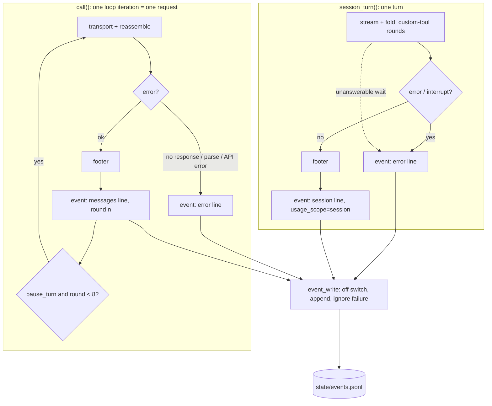

# feat: a private event log, one JSON line per request

## Summary

ask-claude appends one JSON line per API request to `events.jsonl` in the state directory. The Messages path writes one line per request, including each `pause_turn` round. A Managed Agents session writes one line per turn. Failures write a line too. A new `lib/event.jq` builds every line and has goldens like the other jq programs, so the Rust port has one shape to match. `ASK_CLAUDE_EVENTS=off` turns the log off.

---

## Problem Frame

The footer prints model, tokens, cache use, advisor tokens, seconds and stop reason, and then that information is gone. A CLI run lasts seconds, so the request is the unit worth recording, and the script already computes almost every field (see origin: docs/brainstorms/2026-11-07-request-event-log-requirements.md).

---

## Requirements

Carried from the origin doc, with the same IDs.

- R1. Every completed Messages request appends one line: timestamp, chat id, model, the four token counts, stop reason, stop-details category, seconds, API host, and the `pause_turn` round.
- R2. An advisor reply adds the advisor model, call count and token sums.
- R3. Every session turn appends one line with session id, the footer's usage including `list_cost`, stop reason, seconds and custom-tool rounds.
- R4. A failed request appends one line with an error category and no message text.
- R5. Each line carries a schema version and the ask-claude version.
- R6. No line contains prompt, reply, file contents, tool inputs, error text or the key.
- R7. The log lives in the state directory and is private like the history.
- R8. The script only ever appends.
- R9. The off switch writes nothing and creates no file.
- R10. A failed log write never changes stdout, the footer, stderr or the exit code.
- R11. The README documents location, fields, the off switch and five `jq` queries.
- R12. The Rust binary writes the same lines, checked by the same tests.

---

## Key Technical Decisions

- **`lib/event.jq` builds every line.** It is a complete `jq -f` program, like `lib/request.jq`, with goldens in `tests/fixtures/events/`. Its input is the reassembled message (Messages) or the fold (sessions) on stdin. Everything else comes in as `--arg`. This is the jq file contract in `docs/plan.md`, and it gives the Rust port a shape to diff against.
- **The shell passes the timestamp.** `event.jq` takes `--arg ts` rather than calling `now`, so goldens are byte-stable. The shell takes the time from `date -u` in ISO 8601 UTC.
- **One `kind` field and one `chat` field.** `kind` is `messages` or `session`. `chat` holds the history file's name as `list` prints it (`20260102T150405-<pid>`) or the session id (`sesn_…`). A query groups by `chat` and branches on `usage_scope`: it sums `request` lines and takes the maximum of `session` lines.
- **Session usage is cumulative.** `lib/session-fold.jq` takes the last `session.usage`, which covers the session so far, not just the turn. The fixtures confirm it: `sessions/chat/*.sse` and `sessions/custom-tool/*.sse` only grow. The line says so with `usage_scope: "session"`, against `"request"` for Messages lines.
- **One session line per turn.** This supersedes the origin's note that each custom-tool round gets its own line. The fold, and so the usage, is only known once per stream, and it is cumulative, so per-round lines would carry no extra information. The line's `round` is the number of custom-tool rounds answered. Turns that stop after the footer (`requires_action` after the round cap, `terminated`, `budget_reached`) get a normal line with that `stop_reason` and `error: null`.
- **Error category, never error text.** When the error body is JSON with an `error.type`, the category is that type (for example `overloaded_error`). JSON without a type, which is what `ma_call` writes when curl fails, is `no_response`. Otherwise the category is `no_response`, `parse` or `unreadable`. A session also gets `interrupted` and `unanswerable`. The error message is never written, because it can quote request content back.
- **Host only.** `--base-url` already refuses user info (`ask-claude`, the `BASE_URL` check). The line keeps only the host and port, so no path or query string reaches the log.
- **Whole seconds.** The line uses the footer's `$SECONDS` arithmetic. Milliseconds would need `EPOCHREALTIME`, which macOS `/bin/bash` 3.2 lacks, and the field would then have two precisions.
- **`ASK_CLAUDE_EVENTS=off` is the only new variable.** Tests already move the state directory through `XDG_STATE_HOME`, so no path override is needed. Any other value, or unset, means on.
- **A write that fails is silent.** The append's stderr is discarded and its status ignored (R10). A missing log is noticed when someone queries it, and that is soon enough for this kind of data.

---

## High-Level Technical Design

Where lines are written. This is directional, and the prose above is authoritative.



Line shape, directional only. Absent advisor fields are `null`.

```text
{ v: 1, ask_claude: "0.2.x", ts, kind: "messages"|"session", chat, host,
  model, round, seconds, stop_reason, stop_category,
  usage_scope: "request"|"session",
  input_tokens, output_tokens, cache_read, cache_write,
  list_cost (session only), advisor: {model, calls, input_tokens, output_tokens} | null,
  error: null | "<category>" }
```

---

## Implementation Units

### U1. `lib/event.jq` and its goldens

- **Goal:** One jq program turns a reassembled message, a session fold or an error into one compact JSON line.
- **Requirements:** R1, R2, R3, R4, R5, R6.
- **Dependencies:** v0.2.6. The advisor selection and the `sse/advisor*` fixtures.
- **Files:** `lib/event.jq` (new), `tests/unit/event.bats` (new), `tests/fixtures/events/*.json` (new goldens).
- **Approach:** Arguments are `ts`, `version`, `kind`, `chat`, `host`, `round`, `seconds` and `error`. The input on stdin is the message or fold, or `null` for an error line. Advisor fields come from `usage.iterations` with the same selection the footer uses on v0.2.6. `cache_write` on a Messages line is `cache_creation_input_tokens`. On a session line it is the fold's `cache_write`. The output is `jq -c` and keeps a fixed key order, so goldens diff cleanly.
- **Execution note:** Goldens first, as for the other `lib/*.jq` programs: a red test commit, then the program in its child commit (`docs/plan.md`, Graph rule).
- **Patterns to follow:** `lib/request.jq` header comment and argument contract, and `tests/unit/request.bats` golden comparison with `assert_golden`.
- **Test scenarios:**
  - `sse/text.message.json` → golden with `stop_reason: end_turn`, `advisor: null`, `usage_scope: request`, round 0.
  - `sse/advisor.message.json` → `advisor.model`, `calls` and token sums equal what the footer prints for the same fixture.
  - `sse/advisor-redacted.message.json` → advisor fields are still present (redacted advice still has usage).
  - `sse/refusal.message.json` → `stop_reason: refusal`, `stop_category` from `stop_details.category`.
  - `sse/pause-turn.message.json` with `round=3` → `round: 3`, `stop_reason: pause_turn`.
  - `sessions/text.fold.json` and `sessions/budget.fold.json` → `kind: session`, `usage_scope: session`, `list_cost` carried as given.
  - `null` input with `error=overloaded_error` → model and usage fields null, `error: "overloaded_error"`.
  - Privacy: for every golden, no string value contains a text block's text or a tool input from its source fixture.
- **Verification:** `just unit-tests` passes and `shellcheck -x ask-claude` is clean (the check `.github/workflows/lint.yml` runs).

### U2. Write lines on the Messages path

- **Goal:** `call()` writes one line per request, on success and on each failure branch.
- **Requirements:** R1, R2, R4, R7, R8, R9, R10; AE1–AE6.
- **Dependencies:** U1.
- **Files:** `ask-claude`, `tests/unit/events.bats` (new).
- **Approach:** A small `event_write` helper returns at once when `ASK_CLAUDE_EVENTS=off`. Otherwise it appends its argument plus a newline to `$STATE/events.jsonl`. The redirect sits inside a group whose stderr is discarded and whose status is ignored, because bash reports a failed `>>` open before a trailing `2>/dev/null` takes effect. The file inherits `umask 077`. The success line is written right after the footer, inside the loop, so every `pause_turn` round gets its own line. `call()` has two error exits:
  - The empty-log return is `no_response`.
  - The shared `if [ -n "$err" ]` block is fed by three arms. Each arm sets a category variable. A non-SSE body gives its `error.type` when it is JSON with a type, and `unreadable` otherwise. A reassemble failure gives `parse`. An in-stream error event gives the reassembled `.error.type`.
  - The body's type is read before `rm -f "$log"`. The error line is written before `rollback_to`.
  - The host is derived once from `BASE_URL`, near where `API` is set.
- **Patterns to follow:** `transport()` for writing a log without touching the request, and `tests/unit/oneshot.bats` for `replay` with `--separate-stderr`.
- **Test scenarios:**
  - Covers AE1. Replay `text` → `events.jsonl` has exactly one line, it parses, `kind` is `messages`, `chat` equals the history file's name, and the prompt string does not occur in the file.
  - Covers AE2 (partly). Replay `pause-turn` → one line per round, numbered from 0 with no gaps, and the line count equals the `pause_turn: continuing` count plus one. The single-file replay repeats `pause_turn` every round, so this gives 9 lines (rounds 0 to 8), all `pause_turn`. The pause-then-`end_turn` shape needs a multi-file Messages replay (see Deferred to Follow-Up Work).
  - With `events.jsonl` present, `list` and `resume` output is identical to a run without it.
  - Covers AE3. Replay `advisor` → the line's `advisor` is not null, and replay `text` gives `advisor: null`.
  - Covers AE4. Replay `error` → exit 1 as before, one line with an `error` set, and the error message text from the fixture is absent from the file.
  - Covers AE5. `ASK_CLAUDE_EVENTS=off`, replay `text` → no `events.jsonl` in the state directory.
  - Covers AE6. `events.jsonl` pre-created as a directory, replay `text` → stdout, stderr and exit code are identical to a run with no such directory.
  - The file mode is `600` whatever the caller's umask (run under `umask 022`).
  - A second run appends: two runs give two lines, and the first is unchanged.
  - Replay `refusal` → `stop_reason: refusal` with its category.
- **Verification:** The new bats file is green, the existing `oneshot`, `chat` and `history` suites are unchanged and green, and `just lint` is clean.

### U3. Write lines on the session path

- **Goal:** `session_turn()` writes one line per turn and one per failure.
- **Requirements:** R3, R4, R6, R9, R10.
- **Dependencies:** U1, U2 (shares `event_write` and the host).
- **Files:** `ask-claude`, `tests/unit/events.bats`.
- **Approach:** The success line is written next to the session footer after the turn loop, with `rounds` as the round and the fold as input. Six error branches write an error line before `session_cleanup`:
  - events POST error: the `error.type`, or `no_response` for `ma_call`'s untyped curl-failure body.
  - empty stream: `no_response`.
  - parse failure: `parse`.
  - `session.error`: the fold's `error.type`.
  - interrupt: `interrupted`.
  - a `requires_action` wait with nothing this version can answer: `unanswerable`.

  `chat` is the session id.
- **Patterns to follow:** `tests/unit/agent.bats` and `agent-chat.bats` for replaying a session directory.
- **Test scenarios:**
  - Replay session `text` → one line, `kind: session`, `chat` starts with `sesn_`, `list_cost` equals the footer's amount before formatting.
  - Replay session `chat` (two turns) → two lines, and the second line's tokens are greater than or equal to the first's (cumulative).
  - Replay session `custom-tool` → `round` equals the custom-tool rounds answered.
  - Replay session `error` → exit 1, one error line, no error message text.
  - Replay session `waiting-unknown` → exit 1, one error line with `unanswerable`.
  - Replay session `terminated` → exit 1, one normal line with `stop_reason: terminated` and `error: null`.
  - `ASK_CLAUDE_EVENTS=off` with session `text` → no file.
- **Verification:** The session suites are green and unchanged, and the new scenarios are green.

### U4. Document it, and record the Rust obligation

- **Goal:** A reader can find the log, read its fields, turn it off and answer the five questions. The Rust plan names the log as part of parity.
- **Requirements:** R11. R12 is covered here only by recording the obligation in `docs/plan.md`. The Rust implementation stays in Deferred to Follow-Up Work.
- **Dependencies:** U2, U3.
- **Files:** `README.md`, `CHANGELOG.md` (through `just bump`), `docs/plan.md`, `tests/unit/events.bats` (extended).
- **Approach:**
  - README `## Environment`: add an `ASK_CLAUDE_EVENTS` row, and keep "Nothing else is read." true.
  - README: a new `## Events on disk` section after `## Chats on disk`, with location, privacy, a field table, the note that session usage is cumulative, and five `jq` queries. The queries are tokens per chat, cache hit rate (`cache_read / (input + cache_read + cache_write)`), mean and max seconds by model, refusals by category, and advisor tokens by advisor model.
  - `docs/plan.md`: the Phase 4 row for its R6 gains "event log lines" and points at `tests/unit/events.bats`. Its R5 seam already runs these tests against the Rust binary.
  - Version: `just bump` with the effort it measures. The log is new behaviour and a new variable.
- **Test scenarios:** Each README query runs against a file built from the U2 and U3 replays and returns one non-empty result. These go in `tests/unit/events.bats`, so the queries cannot rot.
- **Verification:** `just unit-tests` passes, `just check-version-line` passes, and the README's queries are the ones the tests run.

---

## Scope Boundaries

### Deferred for later (from origin)

- `tracing` spans and OTLP export in the Rust port, off unless an endpoint is set. Revisit only if tool-loop or Managed Agents tracing becomes a real need.
- A Grafana, Tempo and Loki backend (`otel-lgtm`, or Nix-declared services).
- A `stats` subcommand.

### Out (from origin)

- Datadog or any SaaS backend.
- Prices or dollar estimates for Messages requests.
- DuckDB as a dependency.

### Deferred to Follow-Up Work

- Rust implementation of the log. It lands with R6 on the `rust` line, and `tests/unit/events.bats` is its gate.
- HTTP status on error lines. It needs curl to report the status, which touches `transport()` and the replay seam.
- A multi-file Messages replay (one `.sse` per round, as sessions already have), so a test can cover `pause_turn` followed by `end_turn`.

---

## System-Wide Impact

- **State directory:** one new file, `events.jsonl`. `list_chats` and `find_chat` glob `"$STATE"/*.json` and `"$STATE/$1"*.json`, which do not match `.jsonl`. U2 adds one assertion that `list` output is unchanged when the log exists.
- **Privacy:** the log sits next to histories that hold whole conversations, so it adds no new exposure. Keeping prompt and error text out is what lets the log be shared for debugging when the history cannot be.
- **Concurrency:** two runs at once each append one short line in a single `write()` under `O_APPEND`, which keeps lines whole on local filesystems.
- **Growth:** about 400 bytes per request, so 10,000 requests is about 4 MB. There is no rotation (R8).

---

## Risks

| Risk | Mitigation |
| --- | --- |
| An error branch added later forgets to log | All error lines go through `event_write`. U2 and U3 test every branch that exists today. |
| Session cumulative usage is summed by mistake | `usage_scope` is on every line, and the README queries and their tests take the maximum per session. |
| The `chat` id differs between Messages and resume | `chat` is the history file's name, exactly what `list` prints. U2 asserts it. |

---

## Sources & Research

- `ask-claude`: `call()` (Messages loop, footer, error branches), `session_turn()` (session loop and footer), `BASE_URL` validation, `umask 077`, `STATE`.
- `lib/session-fold.jq`: session usage fields, taken from the last `session.usage`.
- [Feat(0.2.6): Advisor](https://github.com/alycda/ask-claude/pull/4): advisor sums from `usage.iterations`, and fixtures `sse/advisor*.sse`.
- `docs/plan.md`: the jq file contract, the Graph rule (test commit, then feat child), and Phase 4 R5/R6.
- `tests/unit/helpers.bash`: `XDG_STATE_HOME` per test, and `ASK_CLAUDE_BIN` for the Rust binary.
