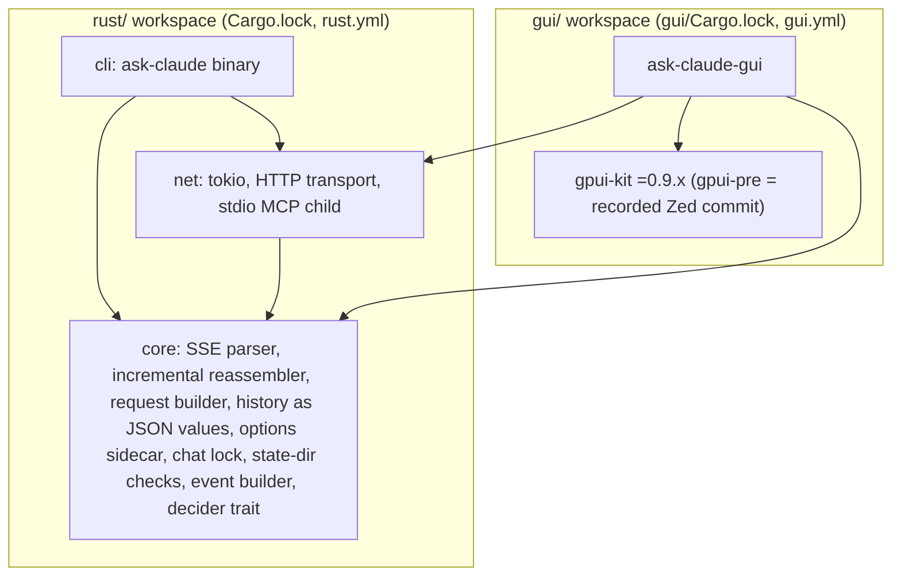
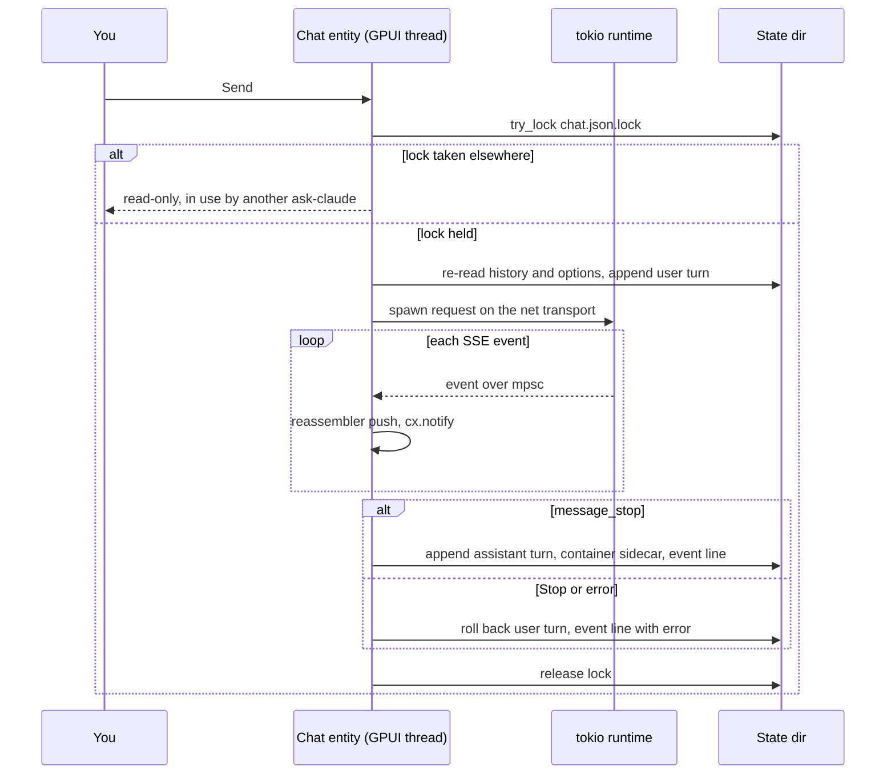
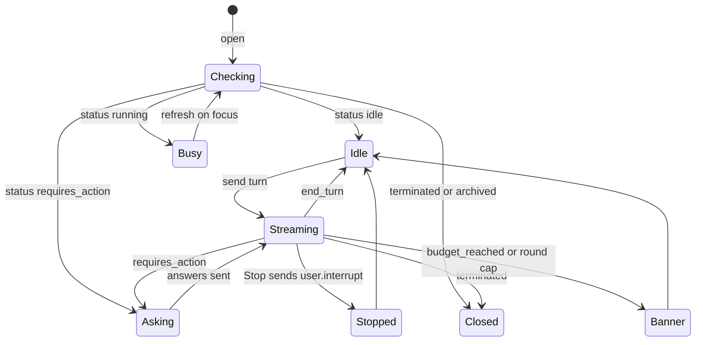

# GPUI Desktop Frontend - Plan

---

## Goal Capsule

- **Objective:** you can hold the same Claude conversations in a native desktop window that you hold in the terminal. A chat or session started in either frontend continues in the other with its options intact. The CLI stays exactly as reproducible and testable as it was at parity.
- **Means:** a GPUI app built on GPUI Kit (`gpui-kit` from crates.io), in its own Cargo workspace at `gui/`, consuming the Rust port's runtime-agnostic core (KTD1, KTD2, KTD4).
- **Authority:** the Product Contract's R-IDs win on behavior; KTDs win on mechanism within them; `docs/plan.md` stays authoritative for port R0–R8 except for the rows U1 amends.
- **Stop conditions:** stop and re-plan if the U2 spike shows that GPUI Kit cannot render a replayed stream from the core without the core taking a tokio dependency. Also stop if a GPUI Kit release drops `TextView` streaming or `Textarea`, or if the parity gate (port R8) changes the chat file format this plan builds on.
- **Execution profile:** two PRs plus one unmerged spike (see Implementation Units). PR1 (U1) lands before port R0 starts. U2 runs after port R5 and is never merged. PR2 (U3–U10) starts after port R8 is merged.
- **Who finishes:** Alyssa writes the code. Claude may write tests and fixtures first, following the owner split in `docs/plan.md`.

---

## Product Contract

### Summary

A desktop chat client for ask-claude, built with GPUI, that reads and writes the CLI's own chats, sessions and event log. The plan adds four guardrails and one throwaway spike to the port R0–R8 port so the core is GUI-ready at parity. After parity it adds a small CLI format change, an options sidecar and a per-turn lock, so the two frontends can share chats safely. Then it builds the app: settings and keychain, the streaming bridge, the transcript, the chat list and composer, and Managed Agents sessions with confirmation dialogs.

### Problem Frame

ask-claude is a hobby rebuild of a Claude Code-style client. This plan writes the port's steps from `docs/plan.md` as port R0 through port R8, so they never collide with its own requirement IDs. The bash script is the oracle, and the Rust port (`docs/plan.md` phase 4) reaches parity at port R8. Every port R0–R8 gate is terminal-shaped: the bats suite on stdout, stderr and exit codes, an empty `usage diff`, and reedline for the chat loop. That is why GPUI was ruled out as the port's toolkit and kept as a second frontend.

A second frontend over the same state has costs the CLI never had to face:

- **Environment:** a GUI launched from a desktop gets no shell environment, so no key, ids, MCP tokens or `XDG_STATE_HOME`.
- **Options:** a chat file stores turns, not the options it ran with.
- **Concurrent writes:** nothing stops two processes writing one chat.
- **Blocking UI:** tool confirmations block on a terminal prompt.
- **Display safety:** the terminal `safe` filter has no meaning in a renderer that can fetch images and open links.

GPUI itself adds two constraints. It is not a tokio runtime. And from crates.io it is only usable through GPUI Kit's `gpui-pre` snapshots (see Sources).

Doing nothing during port R0–R8 has a real price. The core would be written for one terminal consumer: a batch reassembler, typed history, and a confirmation prompt read from `/dev/tty`. Those shapes are cheap to get right now and costly to retrofit after port R8 hardens them.

### Requirements

**Desktop frontend**

- R1. A desktop app holds Messages chats: new chat, send, a streamed reply showing text, thinking and every server-tool block the CLI's stream shows, history, resume, and Stop.
- R2. The app runs Managed Agents sessions: start, resume (including sessions that are not idle), send a turn, Stop, answer tool confirmations, and answer custom tools through a local MCP command set per session.
- R3. Model-, server- and tool-supplied text can never fetch a remote resource, open a link outside an allowlist, or hide part of what a tool confirmation asks to run.
- R4. The key and MCP tokens come from the OS keychain, ids and the local MCP command come from a prefs file, and environment variables override both. The CLI's env-only rule does not change.

**Shared state with the CLI**

- R5. Both frontends use one state directory, resolved the same way and shown in the app. Chat files, names, `.container` sidecars, `sessions/` and `events.jsonl` are shared.
- R6. A chat resumed in the other frontend keeps the options it ran with.
- R7. When both frontends touch one chat, no turn is lost or corrupted. The frontend that cannot take the chat says so and opens it read-only.
- R8. Event log lines from either frontend have the shape the README documents, plus which frontend wrote them. A Stop in the app writes a line.

**Isolation and build**

- R9. The CLI's workspace, lockfile and CI never build GPUI, and a GUI-only change never runs the Rust CLI workflow.
- R10. GUI dependencies are pinned exactly, upgraded only on purpose, and the GUI is built and tested in CI on headless Linux.
- R11. GUI tests run offline against recorded fixtures, with no key, display or GPU.

**Inside port R0–R8**

- R12. The core the CLI ships at port R8 serves the GUI unchanged. It is runtime-agnostic, reassembles incrementally, keeps history losslessly, and takes tool decisions through a frontend-supplied callback.
- R13. One throwaway spike, run after port R5, checks R12 in a GPUI window before port R6–R8 harden the core.

### Key Decisions

- **GPUI is a frontend added after port R8, not the port's toolkit.** (session-settled: user-approved — chosen over building the port itself on GPUI: the port R0–R8 parity gates are terminal-only.) Governs R1, R9.
- **Early spikes inside port R0–R8 are allowed where they pay for themselves.** (session-settled: user-directed — chosen over planning only from finished parity: the core's shape is cheapest to fix before port R6–R8.) Governs R12, R13.
- **Keychain and prefs for the GUI. The CLI stays env-only.** (session-settled: user-directed — chosen over shell-only launch and over a shared config file in the state directory: a dock launch gets no environment, and a shared file would put a secret on disk and change the CLI.) Governs R4, R5.
- **An options sidecar and a per-turn lock, added to the CLI's on-disk format.** (session-settled: user-directed — chosen over a lock with GUI-local options and over GUI forking CLI chats read-only: only this makes resume work both ways without losing turns or options.) Governs R6, R7.
- **One state directory and one event log, shared.** (session-settled: user-approved — chosen over a separate GUI state: "start in one, resume in the other" is the point.) Governs R5, R8.
- **Tests replay the recorded fixtures through GPUI's test context, not bats. Done means you can hold the conversations the fixtures cover, not a pixel spec.** (session-settled: user-approved — chosen over pixel or screenshot tests: they need a GPU or lavapipe and break on every theme change.) Governs R11.

### Success Criteria

- Every recorded Messages fixture in `tests/fixtures/sse/` and every session fixture directory in `tests/fixtures/sessions/` can be replayed through the app's chat or session model. Each produces the same history and event lines the CLI produces from it.
- A chat started in the CLI with `-s`, `--web` and a system prompt resumes in the app with the same request options, and the reverse also holds. The request log shows the same body shape on both sides.
- `rust/Cargo.lock` never contains GPUI Kit, gpui-pre or wgpu entries. The Rust workflow does not run for a commit that touches only `gui/`.

### Scope Boundaries

- No new agent capabilities the CLI lacks: no local bash or file-edit tools, no local tool execution beyond `--local-mcp`. These belong in the core and CLI first.
- No packaging, code signing, notarization, installers or auto-update.
- No pixel or screenshot tests.
- No OpenAI-compatible provider in the app. A chat whose options sidecar names another provider opens read-only.
- Considered and not built: a file watcher on the state directory. The app re-reads a chat under the lock before each send and when the window gains focus, which closes the correctness gap (KTD13). Revisit only if a stale transcript turns out to mislead in practice.
- Considered and not built: per-chat GUI options stored outside the sidecar. The sidecar is the single owner (KTD6).
- Considered and not built: the bash script taking the lock. After port R8 the Rust binary is the CLI, and macOS has no `flock(1)`. See Assumptions.

#### Deferred to Follow-Up Work

- Session operations beyond turns: changing the budget, archive, file download, and opening the Console trace.
- Attaching a file to a prompt (the CLI's `-f`) and uploading files to a session (`agent --file`).
- `check-effver` support for a second `VERSION` under `gui/`. The GUI keeps a manual `gui/CHANGELOG.md` until then.
- The GUI build dependencies in `.devcontainer.json`.
- An OpenAI-compatible provider in the app, once port R7 exists and OpenAI-shape chats have recorded fixtures.

---

## Planning Contract

### Key Technical Decisions

- KTD1. **The GUI is its own Cargo workspace at `gui/`, with its own `Cargo.lock` and workflow, and depends on the core crates by path.** One lockfile would pull GPUI Kit's dependency closure into the CLI's build and CI (about 960 packages across all targets, per GPUI Kit's lockfile). Path dependencies compile the core inside the GUI workspace against the GUI's lockfile, so the core's own dependency list must stay small (KTD4). (session-settled: user-approved — chosen over a member crate inside `rust/`: it would put GPUI into the CLI's lockfile and CI.) Covers R9.
- KTD2. **Depend on `gpui-kit` from crates.io with an exact `=` pin. The Zed revision is the one its `gpui-pre` pin records.** GPUI Kit's widgets (`Textarea`, `TextView` with `push_str` streaming and selection, `MessageScroller`, `Dialog`) are what make a chat UI tractable. They depend on `gpui-pre`, a weekly crates.io republish of a recorded Zed commit (0.3.11 is `zed@f816e1f`). Its types do not unify with git `gpui`, and a Cargo `[patch]` cannot swap packages that have different names. Registry dependencies are also checksummed in `Cargo.lock` and need no clone of the Zed monorepo. Upgrades move `gpui-kit` and `gpui-pre` together, never one `gpui-pre-*` crate alone. (session-settled: user-approved — chosen over hand-rolling an editor, Markdown and selection on bare GPUI: the GUI follows the GPUI revision GPUI Kit pins.) Conflict with the confirmed scope: the scope said "a pinned Zed git revision". Research shows that pin is only reachable through `gpui-pre`, so the pin is exact but comes from the registry, not git. Covers R10.
- KTD3. **The GUI process owns one tokio runtime, and every network and child-process operation runs on it. Events reach GPUI over a runtime-agnostic channel.** GPUI's executors are not tokio, and awaiting tokio IO on them panics with "no reactor running". This follows Zed's own `reqwest_client`: the runtime is a GPUI `Global`, a send spawns onto it, and parsed events go over `futures::channel::mpsc` to an entity task that folds them and calls `cx.notify()`. The entity keeps both the GPUI `Task` and the tokio abort handle, so dropping the entity stops its stream. Chat and session entities live in an app-level registry, not in the visible view, so selecting another chat never cancels a turn. `#[gpui::test]` tests inject the event source, and an injected responder stands in for a local MCP child. They never start tokio, because a waker firing from a foreign thread fails GPUI's determinism check. Code that spawns real processes through `net` is tested in plain tokio tests outside GPUI's test context. Covers R1, R2, R11.
- KTD4. **Guardrails on the core, which the CLI ships at port R8.** Each one is cheap during the port and expensive after:
  1. Crates: `rust/` becomes a workspace from port R0, with `core` (no tokio, reqwest or terminal types), `net` (tokio, the HTTP transport, the stdio MCP child) and `cli` (the `ask-claude` binary).
  2. SSE parsing: the parser turns a stream of byte chunks into events and does not depend on how the bytes are read.
  3. Reassembly: the reassembler is an incremental fold. Pushing one event updates a partial message the frontend can render, and the batch `Message::from_events` (port R2's gate) is built on top of it.
  4. History: history is a list of raw JSON values, only ever appended to or truncated. Typed views are read-only. Re-serializing typed blocks would drop thinking signatures, encrypted advisor content and future block types, and the API would then reject the next turn.
  5. Tool decisions: session tool confirmations and custom-tool calls go through a frontend-supplied decider that is async and runtime-agnostic. Deciding returns a future with no tokio types, the session turn awaits it without blocking a thread, and the frontend may resolve it later from another task. The CLI's decider reads the terminal prompt and `ASK_CLAUDE_CONFIRM` inside that future; the GUI's resolves it from a dialog. A synchronous callback, the natural port of the bash prompt, would block GPUI's main thread or a tokio worker while a dialog waits.
  6. Replay: the replay transport needs no runtime and can deliver a fixture in arbitrary byte chunks, so partial-UTF-8 and mid-event boundaries are testable.
  Covers R12.
- KTD5. **A chat is owned for one turn through an advisory lock on `<chat>.json.lock`.** The lock uses the std `File::try_lock` (stable since Rust 1.89), so no extra crate is needed. A frontend takes it before re-reading the history and releases it after writing the turn or rolling it back. The app also probes the lock (takes it and releases it at once) when a chat opens and on every focus refresh. While another process holds it, the chat is read-only with an "in use by another ask-claude" banner and re-probes on focus. A send that loses the race keeps the typed prompt and shows the same banner. The lock file is created on first use and never deleted, because deleting it reopens the unlink race the lock exists to prevent. Within the app, a chat has at most one turn in flight. Covers R7.
- KTD6. **`<chat>.json.options` holds a chat's request options, versioned: provider, model, effort, system prompt, skills, web, MCP URLs, advisor, max tokens.** It is written when a chat is created and again when options change. On resume, explicit CLI flags override the sidecar and rewrite it. A chat with no sidecar (one written before this change) resumes with defaults, exactly as today. The sidecar never holds a token: MCP tokens stay in the environment or keychain, keyed by host. Covers R6.
- KTD7. **Settings resolution in the GUI:**
  - **Secrets:** the API key and per-host MCP tokens are keychain entries under one service name (the `keyring` crate: Keychain, Secret Service, Credential Manager). The environment overrides them. A local MCP command's own secrets, such as a server token, are environment variables whose names live in prefs and whose values are keychain entries keyed by session id and name. They are injected into that child's environment only, at spawn.
  - **Prefs:** agent and environment ids, each session's local MCP command, and those variable names live in `gui.toml` under the platform config directory, mode 600, never containing a secret. `gui.toml` names commands the app runs, so before reading it the app applies the state directory's checks: not a symlink, owned by you, and neither the file nor its directory writable by group or others. On failure it shows the path and runs env-only. A file readable by others but not writable is re-chmodded to 600.
  - **State directory:** `XDG_STATE_HOME`, then a prefs override, then `$HOME/.local/state/ask-claude`. That is the CLI's default on every OS, macOS included, so the app must not use the platform data directory.
  - **Checks:** the core's state-directory checks (symlink, mode 700, owner, other-writable) run before anything else. On failure the app shows the path and refuses to continue.
  Implements the keychain and prefs Key Decision; covers R4, R5.
- KTD8. **What Stop does:**
  - **Messages chat:** Stop discards the partial reply, rolls the user turn back under the lock, puts the prompt back in the composer, and writes an event line with `error: "interrupted"`. A partial thinking block has no signature, so keeping it would poison the history.
  - **Session:** Stop sends `user.interrupt`, as the CLI's Ctrl-C does.
  - **Closing:** closing a chat or a window, or quitting, with a turn in flight asks first, then stops. Selecting another chat does not stop anything (KTD3).
  - **During a turn:** the composer keeps its text but is read-only, and Send becomes Stop (Esc also stops). The prompt restored after a Stop or an error therefore never overwrites a new draft.
  Covers R1, R2, R8.
- KTD9. **Tool confirmations are per chat, not app-modal.**
  - **Placement:** a waiting session shows its dialog inline and badges its row in the chat list, so other chats stay usable.
  - **Several asks:** asks from one fold are shown in order, each with its own Allow and Deny, and one Submit sends the batch once every ask has an answer, as `session_answer` does.
  - **Default:** deny, as the CLI's `[y/N/a]` prompt does. A new ask never takes keyboard focus from the composer, no send or Enter shortcut answers it, and Allow or Always needs an explicit click or a key press while that button has focus.
  - **"Always":** allows the session's built-in tools until that session is closed or the app quits.
  - **Local tools:** a local custom tool asks every time, because it runs on this machine with your permissions.
  - **`ASK_CLAUDE_CONFIRM`:** the app ignores it.
  Covers R2, R3.
- KTD10. **Display safety, the GUI's version of `safe`:**
  - **Markdown:** rendered with images never fetched (alt text and URL are shown instead). Only `http`, `https` and `mailto` links are allowed; the real target is shown, and a link opens only on click. Raw HTML renders as text.
  - **Confirmation input:** shown as plain monospace text, never Markdown. Bidi controls, zero-width characters and C0/C1 controls are rendered as visible `\u{…}` escapes, the text wraps and scrolls in full, and the byte count is shown. Local tools carry their own label.
  - **Short strings:** window titles, list labels, notifications and server names pass through one core filter that does the same.
  Covers R3.
- KTD11. **Event lines gain a `client` field, `cli` or `gui`. `v` stays 1, and `interrupted` becomes a valid `error` for `kind: messages`.** The field is additive, so every README query keeps working. `ask_claude` is the version of the binary that wrote the line. Both frontends build lines with the core's one event builder and append each line with a single write. Covers R8.
- KTD12. **Opening a session checks its status first:**
  - `idle` opens normally.
  - `running` opens read-only as busy elsewhere.
  - `requires_action` rebuilds the pending asks from the session's events and shows the dialogs.
  - `terminated` and `archived` open as read-only transcripts.
  The status comes from a retrieve-session call that `net` gains for this (the CLI never makes it). A session with no local MCP command in prefs, which includes every session the CLI started with `--local-mcp`, asks for a command or an explicit "none" before sending is enabled. Otherwise the first custom-tool call would be answered "Tool unavailable … Do not call it again", and that instruction stays in the server-side session for good. Each open session that has a local MCP command gets its own child on the tokio runtime. The child's stderr is drained into an in-app log for that session and never written to the state directory, because it can carry tool output. Its process group is stopped when the session closes. Covers R2.
- KTD13. **No file watcher.** The app re-reads a chat under the lock before every send (KTD5), and re-reads the visible chat and the list when the window gains focus. This closes the corruption gap. A watcher would only make the display fresher. Covers R7.

### High-Level Technical Design

Crates and who depends on whom. `rust/` is the CLI's workspace; `gui/` is the app's. Arrows point from a crate to what it depends on.



A Messages turn in the app. The lock is held from re-read to write. Only owned data crosses from tokio to GPUI.



What a session view can be in, and how it moves between states.



### Output Structure

The expected shape of the new workspace. Per-unit file lists are authoritative. `rust/` paths assume the KTD4 workspace layout, which port R0 creates.

```text
gui/
  Cargo.toml
  Cargo.lock
  README.md
  CHANGELOG.md
  src/
    main.rs
    runtime.rs          tokio Global and the bridge
    settings/           keychain, prefs, state-dir resolution
    chat/               chat entity, transcript, blocks, safe text
    session/            session entity, confirmations, local MCP
    app/                root, sidebar, composer, options panel
  tests/
    support/            fixture-backed event sources
    chat.rs
    transcript.rs
    sidebar.rs
    session.rs
    settings.rs
.github/workflows/gui.yml
```

### Assumptions

- After port R8, the Rust binary is the CLI and the bash script is retired or frozen, so the CLI changes in U3 are made in Rust only and tested with bats tests tagged `rust-only` (a tag `justfile` already filters on). If bash is still shipping, it will neither take the lock nor write the sidecar. Its chats still resume with defaults.
- The Rust version that `mise.toml` pins at port R0 is at least what the pinned `gpui-kit` needs: GPUI Kit documents 1.92 or newer, and Zed builds on 1.98.1. The GUI uses the same `mise` pin.

---

## Implementation Units

### PR1: Guardrails in the port plan

Waits on: nothing. Land it before port R0 starts.

### U1. Amend docs/plan.md with the core guardrails and the GPUI pointer

- **Goal:** the port R0–R8 gates enforce KTD4, so the core reaches port R8 GUI-ready without a separate refactor.
- **Requirements:** R9, R12. Implements the "early spikes allowed" Key Decision.
- **Dependencies:** none.
- **Files:** `docs/plan.md`.
- **Approach:**
  1. Add a Decisions row: "Desktop frontend: GPUI, after R8, separate workspace (`docs/plans/2026-11-08-0938-feat-gpui-desktop-frontend-plan.md`)".
  2. Port R0: the scaffold is a workspace with `core`, `net` and `cli`. Add a validation that `core` has no tokio or reqwest in its normal dependencies.
  3. Port R1/R2: the parser takes byte chunks, and the reassembler is an incremental fold with `from_events` built on it. The validation adds "pushing each fixture's events one at a time gives the same message as the batch path".
  4. Port R5: the replay transport needs no runtime and can split a fixture into arbitrary chunks. The validation adds a chunk-boundary test over every `sse/*.sse` fixture.
  5. Port R6: history is a list of raw JSON values. The validation adds "every `*.message.json` fixture round-trips through load, append and save as equal JSON values".
  6. Port R7, where the Sessions transport arrives: session tool decisions go through the async decider in KTD4 item 5, which the CLI implements with the terminal prompt. The validation adds "a `sessions/confirm/` replay completes when the decider's answers arrive over a channel from a separate task after the turn has suspended", run without the core depending on tokio.
  7. Add a short "Phase 5: desktop frontend" pointer to this plan, naming U2 as the spike after port R5.
- **Patterns to follow:** the existing Phase 4 table rows and the "Decisions" table format in `docs/plan.md`.
- **Test expectation:** none. This is a plan amendment. Its validations become tests in port R0, R2, R5, R6 and R7.
- **Verification:** each amended R row states its new validation in the same "Validation" column style. Nothing in the existing R rows is weakened.

### Spike, not merged

### U2. Spike: a replayed fixture rendered in a GPUI window

- **Goal:** prove KTD2–KTD4 hold together before port R6–R8 harden the core. Specifically: the core builds inside a GPUI Kit workspace without pulling in tokio, a stream can be bridged into an entity, and the incremental reassembly gives `TextView` something to stream.
- **Requirements:** R13.
- **Dependencies:** port R5 merged on the port's line.
- **Files:** a scratch crate outside both workspaces and outside the repository's tracked tree. Nothing is committed except edits to this plan.
- **Approach:**
  1. Depend on `gpui-kit` with an exact pin and on `core` by path.
  2. Feed `tests/fixtures/sse/thinking.sse` and `tests/fixtures/sse/code-execution.sse` through the replay transport in small chunks, via a tokio thread and an mpsc channel.
  3. Render the partial message in a `MessageScroller` with a `TextView` per text block.
  4. Write one `#[gpui::test]` that injects the same events without tokio.
  5. Write down the Linux build packages and the toolchain actually needed.
  6. Fold the findings back into this plan's KTDs in place. If KTD4 needs a change, it goes into `docs/plan.md` before port R6. The spike covers the Messages path only; the decider's shape is checked by the port R7 validation U1 adds.
- **Execution note:** a throwaway. Optimize for what it learns, not for code that survives. It ends when the four questions in the goal are answered.
- **Test expectation:** none. The one test in step 4 exists to check that the test seam works, not to guard behavior.
- **Verification:**
  - the window streams both fixtures;
  - `cargo tree` for `core` inside the scratch workspace shows no tokio;
  - the injected-source test passes headless;
  - this plan records the result.

### PR2: The desktop frontend

Waits on: PR1 (merge order only). It also needs port R8 merged before it can start, because U3 changes the Rust CLI's on-disk format and U6 onward consume the parity core. This is a separate PR from PR1 because PR1 must reach main months before this work can begin.

### U3. CLI: options sidecar, per-turn lock, event client field

- **Goal:** the CLI writes and honors `<chat>.json.options`, holds `<chat>.json.lock` for each turn, and writes the `client` field, so the app has a shared format to meet.
- **Requirements:** R6, R7, R8. Implements the sidecar-and-lock Key Decision via KTD5, KTD6 and KTD11.
- **Dependencies:** port R8 merged.
- **Files:**
  - `rust/crates/core/src/chat/options.rs`, `rust/crates/core/src/chat/lock.rs` and `rust/crates/core/src/event.rs` (expected locations under the port R0 layout)
  - `rust/crates/cli/src/` (wiring)
  - `tests/unit/chat-options.bats`, `tests/unit/chat-lock.bats` (tagged `rust-only`)
  - `tests/fixtures/events/*.jsonl` (goldens gain `client`)
  - `lib/event.jq` (gains `client: "cli"` at the same key position as the Rust builder, so one set of goldens stays valid while the bats suite still runs against the bash script; the only bash-side change)
  - `README.md` ("Chats on disk", "Events on disk")
  - `CHANGELOG.md`, `VERSION`
- **Approach:**
  - The sidecar is written alongside the history file through the same temp-file-and-rename the CLI uses for history.
  - The lock wraps the span from history re-read to final write or rollback, including every `pause_turn` round.
  - The chat loop (`resume`, or the loop with no prompt) takes the lock for each turn and re-reads the history and the sidecar from disk before it, so a turn or an option change the app wrote between two loop turns is kept. A one-shot always creates a fresh chat and never contends.
  - A failed lock inside the loop prints a one-line "in use by another ask-claude" refusal, leaves the typed line unsent and the history untouched, and keeps the loop running.
  - The event builder gains `client: "cli"`, and `interrupted` is accepted for messages. The CLI's Ctrl-C behavior (no line) does not change.
  - The changelog entry is meso: the on-disk format grows, and nothing old breaks.
- **Patterns to follow:** `new_chat` and `rollback_to` in `lib/chat.bash` (as ported in port R6), the `.container` sidecar handling in `lib/messages.bash`, and `lib/event.jq` validation of API strings.
- **Test scenarios:**
  - `ask-claude -s pptx --web -S terse "hi"` against `sse/code-execution.sse` writes a sidecar with those options. `resume <chat>` driven through stdin (`again`, then `/quit`) sends a request body with the same skills, web tool and system prompt.
  - `resume <chat>` with `-m <other model>` overrides the sidecar's model and rewrites the sidecar.
  - A chat with no sidecar resumes and sends the same body it sends today.
  - A sidecar with an unknown `v` or invalid JSON: resume refuses with exit 2 and names the file, rather than guessing.
  - With `<chat>.json.lock` held by another process, a `resume <chat>` loop turn prints the "in use" refusal on stderr, the loop continues to `/quit`, and the chat file is byte-identical afterwards.
  - A turn appended to the chat file between two loop turns (by a second process holding the lock) is still present after the loop's next turn.
  - The lock is released after an API error (replay `sse/error.sse`): the rollback is complete, and a second resume can take the lock.
  - A `pause_turn` replay holds the lock across both rounds. A second process trying during round 2 is refused.
  - Event lines carry `client: "cli"`, and every README query in "Events on disk" still returns the same result over the updated goldens.
  - The sidecar never contains an `ASK_CLAUDE_MCP_TOKEN*` value when `--mcp` is used with a token set.
- **Verification:** the new `rust-only` bats files pass against the Rust binary, the full bats suite still passes, the README documents both files and the new field, and `just check-effver` passes.

### U4. GUI workspace, toolchain and CI

- **Goal:** `gui/` builds, opens an empty window, and runs its tests in its own workflow without touching the CLI's build.
- **Requirements:** R9, R10, R11. Implements KTD1 and KTD2.
- **Dependencies:** U3.
- **Files:**
  - `gui/Cargo.toml`, `gui/Cargo.lock`, `gui/src/main.rs`, `gui/src/runtime.rs`
  - `gui/tests/smoke.rs`
  - `.github/workflows/gui.yml`, `.github/workflows/rust.yml` (the isolation step)
  - `justfile` (recipes `gui-build`, `gui-test`, `gui-lint`, `gui-run`)
  - `.gitignore` (`gui/target`)
- **Approach:**
  - Pin `gpui-kit` exactly, with its `test-support` feature in dev-dependencies, and add the dev-profile opt-level overrides GPUI Kit documents for `gpui-pre`, `gpui-pre-platform`, `gpui-component` and `taffy`.
  - Depend on `core` and `net` by path.
  - The runtime `Global` holds the tokio runtime handle (KTD3). Do not use `#[tokio::main]`, because `Application::run` must own the main thread.
  - `gui.yml`:
    - triggers on `gui/**`, `rust/crates/core/**`, `rust/crates/net/**`, `rust/Cargo.toml`, `mise.toml`, `tests/fixtures/**` and its own file;
    - installs the Ubuntu build packages from GPUI Kit's `script/install-linux.sh` (fontconfig, wayland, xkbcommon-x11, x11-xcb, vulkan loader, pkg-config, clang) through apt, and the toolchain through mise;
    - runs build, then tests, then fmt and clippy.
  - `rust.yml` keeps its `rust/**` trigger, so a change under `gui/` alone never runs it. It gains the isolation step that fails when `rust/Cargo.lock` contains `gpui-pre`, because only `rust.yml` runs on the commit that would put it there.
- **Execution note:** mostly scaffolding and CI. Prove it with a headless smoke test and a workflow run rather than with unit tests.
- **Patterns to follow:** `.github/workflows/rust.yml` (mise-action pin, rust-cache, a step per gate) and the recipe comments in `justfile`.
- **Test scenarios:**
  - a `#[gpui::test]` builds the root view in a `TestAppContext` and finds the empty-state text;
  - `cargo tree` in `rust/` shows no `gpui-pre` (a `rust.yml` step that fails if one appears).
- **Verification:** `just gui-test` passes locally and in `gui.yml` on `ubuntu-latest` with no display, `just actionlint` passes, and a commit touching only `gui/` does not start the Rust workflow.

### U5. Settings, keychain and state directory

- **Goal:** the app finds the key, tokens, ids and the same state directory as the CLI, or tells you exactly what is missing.
- **Requirements:** R4, R5. Implements KTD7.
- **Dependencies:** U4.
- **Files:** `gui/src/settings/mod.rs`, `gui/src/settings/keychain.rs`, `gui/src/settings/prefs.rs`, `gui/src/settings/state_dir.rs`, `gui/src/app/first_run.rs`, `gui/tests/settings.rs`.
- **Approach:**
  - Use one resolver per value, in the order KTD7 gives.
  - The keychain is behind a trait, so tests use an in-memory store.
  - The first-run view asks for the key and stores it in the keychain, never in the prefs file.
  - The settings view shows the resolved state directory and which source supplied each value: env, keychain or prefs. It never shows the secret.
  - When the platform has no keychain (Linux without Secret Service), the app says so and works from the environment only.
- **Patterns to follow:** the state-directory checks and their messages in `lib/config.bash`, as ported to `core` in port R6.
- **Test scenarios:**
  - `ANTHROPIC_API_KEY` set and a keychain entry present: the environment value is used, and the source shows "env".
  - No env and no keychain entry: the first-run view appears, and saving writes the keychain only. The prefs file is unchanged and never contains the key.
  - `XDG_STATE_HOME` unset and no prefs override: the state directory is `$HOME/.local/state/ask-claude` on every OS.
  - The state directory is a symlink, or is owned by another uid: a blocking error view names the path, and no request is possible.
  - The prefs file is created with mode 600. A prefs file with mode 644 is re-chmodded to 600. A group-writable prefs file, one owned by another uid, a symlinked one, and one in a group-writable directory are each refused, with the path shown and the app running env-only.
  - A local MCP variable saved for a session is stored in the keychain, `gui.toml` holds only its name, and the value reaches that session's child environment and no other.
  - MCP tokens: one keychain entry per host, read only for the server with that host. With several `--mcp` servers configured, the shared-token refusal from `lib/config.bash` applies the same way.
  - The keychain backend reports itself unavailable: there is a banner, and env-only operation still works.
- **Verification:** the settings tests pass with the in-memory keychain. A manual run on one desktop OS stores and reads the key through the real keychain.

### U6. Chat model and the streaming bridge

- **Goal:** a chat entity that sends a turn through the shared lock, sidecar and history, folds the stream incrementally, and handles every outcome the CLI handles.
- **Requirements:** R1, R5, R6, R7, R8. Implements KTD3, KTD5, KTD8 and KTD11.
- **Dependencies:** U5.
- **Files:** `gui/src/chat/model.rs`, `gui/src/runtime.rs`, `gui/tests/support/fixtures.rs`, `gui/tests/chat.rs`.
- **Approach:**
  - The entity holds the history (raw JSON values), the options and the partial message, plus the stream `Task` and the tokio abort handle.
  - Send follows the second High-Level Technical Design diagram: take the lock, re-read, append, stream, then write or roll back, then release.
  - `pause_turn` continues up to 8 rounds, as `lib/messages.bash` does.
  - A container error drops the `.container` sidecar.
  - A new chat creates its history file and sidecar on the first send, never on "New chat", using the CLI's name scheme and collision loop.
  - In tests, the fixtures support module replays a fixture as an injected event source, with no tokio involved.
  - A failed turn shows an inline banner above the composer with the API error type and message, passed through the core short-string filter. An authentication error adds an "Open settings" action.
- **Execution note:** test-first against the recorded fixtures. The CLI's goldens for the same fixture are the expected history and event lines.
- **Patterns to follow:** `ask` and `call` in `lib/messages.bash` (as ported in port R5/R6), `new_chat` in `lib/chat.bash`, and the KTD3 bridge.
- **Test scenarios:**
  - Covers the success criterion: `sse/text.sse` produces history equal to the CLI's for the same prompt, and one event line with `client: "gui"`.
  - `sse/thinking.sse` streams thinking, then text, into the partial message, and the stored assistant turn keeps the signature unchanged.
  - `sse/pause-turn.sse` continues automatically, writes one event line per round, and appends one assistant turn per round, so the history equals the CLI's for the same replay.
  - `sse/refusal.sse` stores the turn and exposes the stop category for display, with no error.
  - `sse/error.sse` rolls back the user turn, puts the prompt back in the composer, writes an error line, and leaves the history file byte-identical to before.
  - `sse/code-execution.sse` writes `<chat>.json.container`, and the next send carries the container id.
  - With the lock held by another process when the chat opens, the chat is read-only with the "in use" banner, send is disabled, and nothing is written. After the other process releases the lock, the next focus refresh makes the chat writable again.
  - A send that loses the lock race keeps the typed prompt in the composer and shows the banner.
  - `sse/error.sse` shows the error banner with the error type.
  - Stop mid-stream: no partial turn is stored, the user turn is rolled back, the line has `error: "interrupted"`, and the lock is released.
  - Selecting another chat mid-stream leaves the turn running, and it completes and saves. Closing the chat mid-stream asks first, then cancels the stream and releases the lock.
  - The fixture is delivered in 1-byte chunks, splitting multi-byte characters: the final history equals the unchunked run.
  - A CLI-written history containing `advisor-redacted` blocks is appended to and saved, and the earlier turns are equal as JSON values.
- **Verification:** all chat tests pass headless. A manual live send against the API streams and saves a turn that `ask-claude resume` continues.

### U7. Transcript rendering and display safety

- **Goal:** the transcript shows everything the CLI's stream shows, with structure instead of tags, and model text cannot reach the network or hide content.
- **Requirements:** R1, R3. Implements KTD10.
- **Dependencies:** U6.
- **Files:** `gui/src/chat/transcript.rs`, `gui/src/chat/blocks.rs`, `gui/src/chat/safe_text.rs`, `rust/crates/core/src/display.rs` (the shared short-string filter), `tests/fixtures/gui/hostile-markdown.sse`, `gui/tests/transcript.rs`.
- **Approach:**
  - `MessageScroller` with tail-follow and one row per turn. Streaming appends go through `TextView` `push_str`, and the growing row is remeasured.
  - Block views:
    - thinking collapses by default;
    - web search and fetch show the query or URL;
    - code execution shows the return code;
    - MCP shows the server name;
    - advisor shows advice, or "encrypted";
    - refusal shows a banner with the category.
  - Markdown link and image handling are configured or wrapped so KTD10 holds whatever the widget's defaults are.
  - The core filter for short strings is shared with the CLI's `safe` behavior.
- **Patterns to follow:** the block list in `lib/stream.jq`, which is the inventory of what must be visible.
- **Test scenarios:**
  - Each fixture in `tests/fixtures/sse/` yields the block kinds `lib/stream.jq` tags for it, in order. Assert on the view model, not pixels; `NoopTextSystem` gives no real metrics.
  - The thinking block is collapsed by default, and expanding it shows the full thinking text.
  - Hostile Markdown with ``: no HTTP request is made (the test HTTP client records none), and the alt text and URL are visible.
  - A `javascript:` link and a `file:` link render as inert text. An `https` link shows its real target and opens only through the click handler.
  - Raw `` and `<script>` in Markdown render as literal text.
  - `events/hostile.message.json` content in a list label and the window title shows its control characters and bidi overrides as visible escapes, as KTD10's short-string filter does.
  - A long reply streams with tail-follow on, and scrolling up turns tail-follow off until the jump-to-bottom control is used.
- **Verification:** transcript tests pass headless. A manual run with each fixture shows every block kind.

### U8. Chat list, composer and options panel

- **Goal:** pick, start and resume chats, write prompts, and see and change a chat's options the way the CLI's flags do.
- **Requirements:** R1, R2, R5, R6. Builds on KTD3, KTD6, KTD8 and KTD13.
- **Dependencies:** U7.
- **Files:** `gui/src/app/root.rs`, `gui/src/app/sidebar.rs`, `gui/src/app/composer.rs`, `gui/src/app/options_panel.rs`, `gui/src/app/new_session.rs`, `gui/tests/sidebar.rs`.
- **Approach:**
  - The sidebar lists chats newest first by modification time, as `ls -t` does, with the first-prompt excerpt and turn count. Below them it lists sessions from `sessions/`. A row with a turn in flight shows a streaming indicator.
  - "New session" opens a form with agent id and environment id (prefilled from prefs), an optional local MCP command with its variable names, and Start. Start writes the values to prefs and creates the session. A missing id, or one the API rejects, shows a field error and creates nothing.
  - The composer is a `Textarea` with auto-grow. Cmd- or Ctrl-Enter sends, and Shift-Enter adds a newline. This also covers the multi-line paste bug that `docs/plan.md` carries. During a turn it follows KTD8: read-only, with Send replaced by Stop.
  - The options panel edits model, effort, system prompt, skills, web, MCP URLs and advisor, and writes the sidecar.
  - Focus refresh follows KTD13.
- **Patterns to follow:** `list_chats` and `find_chat` in `lib/chat.bash`.
- **Test scenarios:**
  - Two chat files with different modification times list newest first, with counts and excerpts matching `ask-claude list` for the same directory.
  - A `[]` file (a CLI chat loop in progress) is listed but skipped by "resume newest". A malformed file is listed as unreadable and cannot be opened for sending.
  - "New chat" then closing without sending leaves no file in the state directory.
  - A CLI chat with a sidecar naming `-s pptx` opens with skills shown, and sending reuses the container from `.container`.
  - A chat whose sidecar names provider `openai` opens read-only with an explanation.
  - A pasted multi-line prompt is one user turn.
  - While a turn streams, the composer is read-only and shows Stop. After Stop, the composer holds the restored prompt and is editable.
  - "New session" with prefilled ids starts a session and stores its local MCP command for the new session id. With the environment id missing, Start shows a field error and no session is created.
  - When the window gains focus after the CLI appended a turn to the open chat, the new turn appears.
- **Verification:** sidebar tests pass headless. In a manual cross-check, start a chat in the CLI, continue it in the app, then continue it in the CLI. The request log shows the same option-derived fields on all three turns.

### U9. Managed Agents sessions

- **Goal:** sessions run in the app with the CLI's semantics, with confirmations as per-chat dialogs and local custom tools answered by a per-session MCP child.
- **Requirements:** R2, R3, R5, R8. Implements KTD8, KTD9 and KTD12.
- **Dependencies:** U8.
- **Files:**
  - `gui/src/session/model.rs`, `gui/src/session/confirm.rs`, `gui/src/session/local_mcp.rs`
  - `rust/crates/net/src/` (the retrieve-session call)
  - `gui/tests/session.rs` (GPUI tests, injected sources and an injected MCP responder)
  - `rust/crates/net/tests/local_mcp.rs` (plain tokio tests of the real child)
  - `tests/fixtures/sessions/open-running/` and `tests/fixtures/sessions/open-requires-action/` (hand-written: a retrieve-session body and an `events.json` each), plus those two files added to `tests/fixtures/sessions/terminated/`
- **Approach:**
  - The session entity drives the core's session turn with the GUI decider.
  - The decider parks each ask on the entity, renders it through the KTD10 confirmation view, and resolves it when you answer.
  - Status on open follows KTD12 and the state diagram above, including the local MCP command prompt for a session with none in prefs.
  - The local MCP child is spawned through `net` on the tokio runtime, using the command stored in prefs for that session id. Its handshake failure blocks sending in that session and shows the error.
  - Budget and cost from the fold appear in the session header. `budget_reached`, the custom-round cap and `terminated` show banners.
  - Sessions are remembered in `sessions/` after the first successful turn, exactly as the CLI does.
- **Patterns to follow:** `session_answer`, `session_confirm` and `session_turn` in `lib/agent-turn.bash`, and `local_mcp_*` in `lib/local-mcp.bash` (all as ported in port R7).
- **Test scenarios:**
  - `sessions/chat/` replays three turns, and the transcript and event lines match the CLI's goldens with `client: "gui"`.
  - `sessions/confirm/`: allow sends a `user.tool_confirmation` with `result: allow` for each ask id, and deny sends `deny`.
  - "Always", then a second ask in the same session: no dialog, allowed. After reopening the session, the dialog is back.
  - `sessions/custom-tool/` with an injected MCP responder: each local call shows a dialog every time, even after "always", and an allowed call reaches the responder with the recorded input.
  - Opening the CLI-created `sessions/custom-tool/` session with no prefs entry blocks send until a command or "none" is chosen, and no "Tool unavailable" result is sent before that choice.
  - With an ask pending, Cmd-Enter in the composer sends no answer. Submit stays disabled until every ask in the batch has Allow or Deny, and a fresh dialog has Deny focused only after an explicit Tab or click.
  - A custom tool the server does not list gets the unavailable error, and no dialog is shown.
  - A confirmation input containing U+202E and a zero-width joiner shows both as escapes, and the byte count matches the raw input.
  - `sessions/budget.sse` shows the budget banner. `sessions/terminated/` opens as a read-only transcript.
  - Opening a session whose status is `running` (`sessions/open-running/`) is read-only with "busy elsewhere".
  - Opening `sessions/open-requires-action/` rebuilds its pending asks as dialogs.
  - Stop during a session turn sends `user.interrupt` and writes an `interrupted` line.
  - In a plain tokio test of `net`, `tests/fixtures/mcp/fake-server` receives a call with the recorded input, its stderr is captured to the session log sink and not the state directory, and stopping the session stops its process group (the fake server's log shows the session ended).
- **Verification:** session tests pass headless. A manual live session against a test agent with one *ask* tool shows the dialog and continues after allow.

### U10. Documentation and the GUI's version

- **Goal:** someone can build, configure and run the app from the docs, and the repository's map points at it.
- **Requirements:** R4, R9, R10.
- **Dependencies:** U9.
- **Files:** `gui/README.md`, `gui/CHANGELOG.md`, `README.md` (a short "Desktop app" section with a link), `docs/plan.md` (mark phase 5 as this plan).
- **Approach:**
  - `gui/README.md` covers:
    - build packages per OS (Ubuntu list; macOS Command Line Tools with GPUI Kit's runtime-shader feature; Windows MSVC);
    - where the key, tokens and prefs live, and that env wins;
    - how the state directory is resolved;
    - lock and sidecar behavior when both frontends are open;
    - that a session started in the app and resumed in the CLI needs `--local-mcp` again;
    - how to upgrade `gpui-kit`.
  - `gui/CHANGELOG.md` starts at 0.1.0, in the EffVer heading format the root changelog uses.
- **Patterns to follow:** the root `README.md` tone and table style, and the `CHANGELOG.md` heading format.
- **Test expectation:** none. Documentation only.
- **Verification:** a fresh clone on Linux reaches a running window by following `gui/README.md` alone, and every link in the new sections resolves.

---

## Verification Contract

| Gate | Command | Applies to | Proves |
|---|---|---|---|
| Bats, both binaries | `just unit-tests`, and the port R8 recipe that runs the suite against the Rust binary | U3 | CLI behavior is unchanged except for the documented additions |
| New CLI tests | `just unit-test chat-options`, `just unit-test chat-lock` | U3 | sidecar, lock, and event `client` field |
| Effort and changelog | `just check-effver` | U3 | the CLI release heading matches `VERSION` |
| GUI build | `just gui-build` | U4–U9 | the workspace builds with the pinned `gpui-kit` |
| GUI tests | `just gui-test` (headless `#[gpui::test]`, `test-support` feature) | U4–U9 | fixture replays, settings, safety, sessions |
| GUI lint | `just gui-lint` (fmt check, clippy with warnings denied) | U4–U9 | style and lints |
| Workflow lint | `just actionlint` | U4 | `gui.yml` and the changed `rust.yml` are valid |
| Isolation | the `rust.yml` step that fails if `rust/Cargo.lock` contains `gpui-pre`, plus a `gui/`-only commit that does not start `rust.yml` | U4 | R9 |
| Local MCP child | `cargo test` in `rust/` for `net`'s local MCP tests | U9 | the real child process, outside GPUI's test context |
| Live check | a manual send and a manual session turn with a real key | U6, U9 | the bridge against the real API; never run in CI |

---

## Definition of Done

- Every R-ID is covered by at least one unit's passing tests or by the verification above. The success criteria hold.
- `just gui-test`, `just gui-lint`, `just actionlint` and the full bats suite pass in CI on the merge commit.
- `rust/Cargo.lock` contains no GPUI Kit, gpui-pre or wgpu packages.
- The README documents the options sidecar, the lock, and the `client` field. `gui/README.md` documents build, settings and upgrade.
- No spike code from U2 is in the repository. U2's findings have been folded into this plan's KTDs or into `docs/plan.md`.
- Abandoned approaches, dead code and commented-out experiments are removed from the diff.

---

## Risks & Dependencies

| Risk | Mitigation |
|---|---|
| GPUI Kit ships a breaking 0.x release every 2–3 weeks, and `gpui-pre` weekly. | Exact `=` pin and a committed `gui/Cargo.lock`. Upgrade on purpose, with `just gui-test` as the gate. Never override a single `gpui-pre-*` crate. |
| The `gpui-pre` maintainer stops publishing snapshots. | KTD2's fallback is a fork of GPUI Kit with its workspace `gpui` entries repointed at a Zed git revision. That is real ongoing work, so it is a fallback, not a plan. |
| Stock reqwest's body may need a tokio context when polled. Zed uses a fork, and this is unverified. | KTD3 already pumps the whole body inside tokio and sends parsed events, so no reqwest future is polled on GPUI. |
| GPUI Kit's `TextView` may fetch Markdown images by default. Its default behavior is unverified. | U7 wraps or configures the image and link path, and its hostile-Markdown test fails on any recorded HTTP request. |
| The pinned Rust toolchain is too old for `gpui-kit`. | A U2 finding. The pin is raised in `mise.toml` before U4. |
| Linux builds need system packages that mise cannot provide. | apt in `gui.yml` and documented in `gui/README.md`. The devcontainer is deferred. |
| A crash while holding the lock. | OS advisory locks are released when the process exits, so no stale-lock cleanup is needed. |

---

## Sources

- `docs/plan.md`: Decisions, Phase 4 (R0–R8), the parity gate, and the known multi-line paste bug.
- `lib/chat.bash` (`new_chat`, `rollback_to`, `list_chats`, `find_chat`), `lib/messages.bash` (`ask`, `call`, `pause_turn` rounds, `.container`), `lib/config.bash` (state-directory checks, MCP token rules), `lib/agent-turn.bash` (`session_confirm`, `session_answer`, `session_turn`), `lib/local-mcp.bash`, `lib/stream.jq` (the block inventory and `safe`), `lib/event.jq`.
- `docs/plans/2026-11-07-001-feat-request-event-log-plan.md`: event line shape and the validated-string rule.
- `tests/fixtures/sse/`, `tests/fixtures/sessions/`, `tests/fixtures/events/hostile.*` and `tests/fixtures/mcp/fake-server`: the replay inputs every GUI test reuses.
- Zed at `b5cd310b` (2026-11-07): `crates/gpui/src/app.rs`, `crates/gpui/src/app/test_context.rs`, `crates/scheduler/src/test_scheduler.rs` (foreign-thread wake detection), `crates/gpui/src/elements/list.rs`, `crates/gpui/src/window/a11y.rs`, `crates/gpui_platform/src/gpui_platform.rs`, and `crates/reqwest_client/src/reqwest_client.rs` (the tokio-runtime-beside-GPUI pattern).
- GPUI Kit (formerly gpui-component) at `8da4e005` (2026-11-08): root `Cargo.toml` (the `gpui-pre =0.3.11` pins), `script/bump-gpui.ts`, `.github/workflows/ci.yml` (headless tests on `ubuntu-latest`), `script/install-linux.sh`, `crates/component/src/message_scroller.rs`, `crates/component/src/input/textarea.rs`, `crates/base/src/text/state.rs` (`push_str`), and `examples/stream-markdown/`.
- crates.io as of 2026-11-08: `gpui` 0.2.2 (2025-10-22, stale), `gpui_platform` not published, `gpui-pre` 0.3.11, `gpui-kit` and `gpui-component` 0.9.0.
- Zed's `markdown` and `anthropic` crates are GPL-3.0. Read them for patterns only and copy nothing.

---

## Deferred / Open Questions

Review items left for the author. None of them blocks implementation.

### From 2026-11-08 review

- **The first success criterion cannot pass as written, because GUI event lines carry a different `client` value** — Product Contract: Success Criteria, first bullet (P2, coherence, confidence 75)

  A tester running the first success criterion literally finds every GUI event line different from the CLI's: lines now carry `client: "gui"` or `client: "cli"` (KTD11, the event-line field). U6 and U9 require `client: "gui"`, so the check fails and testers have to improvise an exception.

  Change: say that the history and event lines match the CLI's except for the `client` field KTD11 defines.
